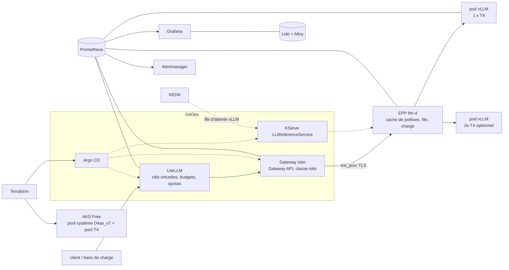

# Lab d'inférence LLM sur AKS (T4)

vLLM · llm-d · KServe · Istio · LiteLLM · KEDA · Prometheus / Grafana / Alertmanager · Loki — **100 % Terraform + GitOps (Argo CD)**.

Lab d'apprentissage de l'optimisation d'inférence (GPU, modèles, cluster) : reproductible, bon marché, mesurable.
Ce n'est pas une production.

## Architecture



Détails : [docs/ARCHITECTURE.md](docs/ARCHITECTURE.md). Décisions et écarts avec le prompt d'origine : [docs/DECISIONS.md](docs/DECISIONS.md).

## Démarrage en cinq commandes

```bash
cp .env.example .env            # AZ_SUBSCRIPTION_ID, AZ_LOCATION=eastus ...
./lab.sh preflight              # outils, session az, quota T4, SKU, providers
./lab.sh up                     # terraform apply + Argo CD + attente de convergence + smoke
./lab.sh bench smoke            # puis sweep, steady, shared-prefix, multi-turn, long-prompt, burst
./lab.sh down --yes             # tout détruire (aucune ressource facturée ne reste)
```

Autres commandes : `status`, `ui` (port-forwards Grafana/Prometheus/Alertmanager/Argo CD/LiteLLM), `scenario <nom>`,
`gpu-scale <0-2>`, `stop` / `start`, `cost`, `versions`, `kind-up` / `kind-down` (tests locaux sans GPU).

## Coûts (eastus, Linux, pay-as-you-go, Azure Retail Prices du 16/11/2026)

| Poste | Prix |
|---|---|
| `Standard_NC4as_T4_v3` (1 GPU T4, 4 vCPU, 28 Gio) | 0,526 $/h |
| `Standard_D4as_v7` (pool système, 4 vCPU, 16 Gio) | 0,182 $/h |
| AKS tier Free, disque OS T4 éphémère, ~1 IP publique | ~0 |
| **1 T4 + système** | **0,708 $/h (≈ 17 $/jour)** |
| 2 T4 + système | 1,234 $/h (≈ 29,6 $/jour) |

Le quota T4 de l'abonnement est de 8 vCPU (2 nœuds) en `eastus` uniquement ; le quota Spot (3 vCPU) ne permet pas de T4 Spot.
Leviers : `lab.sh stop` (VM désallouées), `gpu-scale 0`, `down`. Une alerte signale un GPU inactif depuis 30 minutes.

## Structure

```
lab.sh                  pilotage (kind et AKS)
infra/terraform/        AKS, pool GPU, Argo CD, secrets, application racine
gitops/root/            app-of-apps : une Application par composant (+ versions.yaml, source unique des versions)
gitops/platform|observability|gateway|serving|bench   composants
gitops/scenarios/       un fichier par scénario ; gitops/active-<env>.yaml = scénario actif (Git)
tests/                  static.sh (validations gratuites), promtool, test KEDA
results/                résultats des benchs
docs/                   ARCHITECTURE, DECISIONS, RUNBOOK, METRIQUES, BASELINE, runbooks/
```

Sécurité : aucun secret dans Git (générés par Terraform, état local ignoré) ; le lab ne touche qu'au groupe de ressources
`inflab-rg` et n'utilise aucun snapshot.
