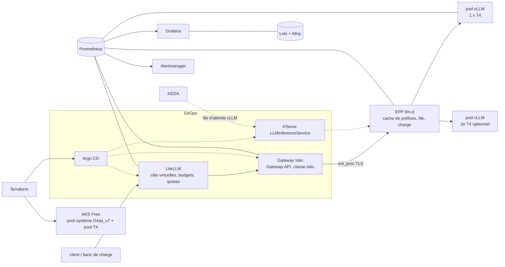

# Lab d'inférence LLM sur AKS (T4)

vLLM · llm-d · KServe · Istio · LiteLLM · KEDA · Prometheus / Grafana / Alertmanager · Loki — **100 % Terraform + GitOps (Argo CD)**.

Lab d'apprentissage de l'optimisation d'inférence (GPU, modèles, cluster) : reproductible, bon marché, mesurable.
Ce n'est pas une production.

**En une phrase.** Un petit cluster Azure (1 GPU T4) sur lequel on fait tourner un modèle de langage, qu'on crée et détruit par des commandes, et dont on mesure tout (vitesse, mémoire, coût) pour apprendre à l'optimiser.

**Si vous débutez**, lisez dans cet ordre : le [glossaire](docs/sre/GLOSSAIRE.md) (les 12 premiers mots), le [guide](docs/guide/README.md), puis la [formation](docs/formation/README.md).

<!-- mots: inférence, llm, token, vram, vllm, gitops -->
> **Mots à connaître**
> - **Inférence** : Faire répondre un modèle déjà entraîné (par opposition à l'entraîner). Ce cluster ne fait que ça.
> - **LLM** : *Large Language Model* : un modèle qui produit du texte, un morceau (token) à la fois.
> - **Token** : Le morceau de texte que le modèle lit et écrit (un mot courant fait environ 1 à 2 tokens). C'est l'unité de tous les calculs.
> - **GPU / VRAM** : Le processeur de calcul (ici un NVIDIA T4) et sa mémoire (16 Go). Le modèle et le cache KV doivent y tenir.
> - **vLLM** : Le programme qui charge le modèle sur le GPU et répond aux requêtes. Le « moteur ».
> - **GitOps** : L'état voulu du cluster est écrit dans Git ; Argo CD le fait appliquer. On ne modifie pas le cluster à la main.
> - Tous les mots : [glossaire](docs/sre/GLOSSAIRE.md).
<!-- /mots -->

## Architecture



Détails : [docs/ARCHITECTURE.md](docs/ARCHITECTURE.md). **Documentation technique complète (inférence, architecture, sécurité, observabilité, GPU, une fiche par service) : [docs/guide/](docs/guide/README.md) et [docs/services/](docs/services/00-index.md).** **Santé et efficacité du GPU (signaux, KPI, dashboards, arbres de décision, séance de mesures) : [docs/gpu/](docs/gpu/README.md).** **Formation avec les vrais chiffres du cluster (mesure, classes de charge, SLO, burn rate, lire un GPU, démarrage à froid) : [docs/formation/](docs/formation/README.md) ; campagne SRE : [docs/sre/](docs/sre/SEANCES.md).** Décisions et écarts avec le prompt d'origine : [docs/DECISIONS.md](docs/DECISIONS.md).

## Démarrage en cinq commandes

```bash
cp .env.example .env            # AZ_SUBSCRIPTION_ID, AZ_LOCATION=eastus ...
./lab.sh preflight              # outils, session az, quota T4, SKU, providers
./lab.sh up                     # terraform apply + Argo CD + attente de convergence + smoke
./lab.sh bench smoke            # puis sweep, steady, shared-prefix, multi-turn, long-prompt, burst
./lab.sh down --yes             # tout détruire (aucune ressource facturée ne reste)
```

Autres commandes : `status`, `ui` (port-forwards Grafana/Prometheus/Alertmanager/Argo CD/LiteLLM), `scenario <nom>`,
`gpu-scale <0-2>`, `stop` / `start`, `cost`, `versions`, `idle` et `snapshot-metrics` (garde-fous de coût, non testés sur cluster), `kind-up` / `kind-down` (tests locaux sans GPU).
Mesurer par classe de charge : `tests/classes.sh` ; détail dans le [runbook](docs/RUNBOOK.md).

## Coûts (eastus, Linux, pay-as-you-go, Azure Retail Prices du 16/11/2026)

| Poste | Prix |
|---|---|
| `Standard_NC4as_T4_v3` (1 GPU T4, 4 vCPU, 28 Gio) | 0,526 $/h |
| `Standard_D4as_v7` (pool système, 4 vCPU, 16 Gio) | 0,182 $/h |
| AKS tier Free, disque OS T4 éphémère, ~1 IP publique | ~0 |
| **1 T4 + système** | **0,708 $/h (≈ 17 $/jour)** |
| 2 T4 + système | 1,234 $/h (≈ 29,6 $/jour) |

Le quota T4 de l'abonnement est de 8 vCPU (2 nœuds) en `eastus` uniquement ; le quota Spot (3 vCPU) ne permet pas de T4 Spot.
Leviers : `lab.sh stop` (VM désallouées), `gpu-scale 0`, `down`. Une alerte signale un GPU inactif depuis 30 minutes.

## Structure

```
lab.sh                  pilotage (kind et AKS)
infra/terraform/        AKS, pool GPU, Argo CD, secrets, application racine
gitops/root/            app-of-apps : une Application par composant (+ versions.yaml, source unique des versions)
gitops/platform|observability|gateway|serving|bench   composants
gitops/scenarios/       un fichier par scénario ; gitops/active-<env>.yaml = scénario actif (Git)
tests/                  static.sh (validations gratuites), promtool, scripts de mesure (classes, goodput, bruit, démarrage à froid), générateurs de docs
results/                résultats des benchs et de l'essai d'alerte
docs/                   guide/ (comprendre), formation/ (apprendre avec les chiffres), services/ (une fiche par composant), sre/ (SLO, séances, glossaire),
                        ARCHITECTURE, DECISIONS, RUNBOOK, METRIQUES, BASELINE, reference/, runbooks/
```

Sécurité : aucun secret dans Git (générés par Terraform, état local ignoré) ; le lab ne touche qu'au groupe de ressources
`inflab-rg` et n'utilise aucun snapshot.
