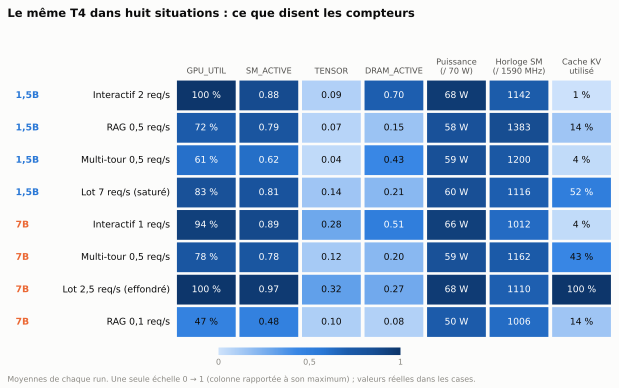
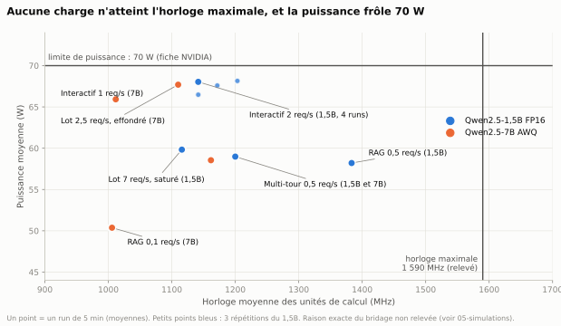
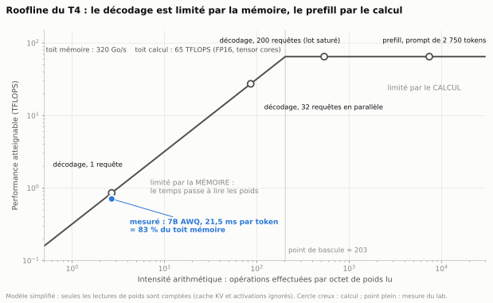

# 01 - Les signaux du GPU : ce que chaque compteur dit vraiment

**En une phrase.** Un GPU expose des dizaines de compteurs ; chacun répond à une question précise (travaille-t-il ? lit-il la mémoire ? consomme-t-il trop ? est-il bridé ? est-il malade ?), et aucun ne répond à toutes.
Ce chapitre les range par famille, donne leurs **valeurs réelles sur le T4 du lab** et explique les pièges.

<!-- mots: gpu_util, sm_active, sm, tensor core, dcgm, nvidia-smi, horloge, raisons de bridage, ecc, retrait de pages, roofline, mfu -->
> **Mots à connaître**
> - **GPU_UTIL** : Part du temps où *au moins un* calcul tournait. **100 % ne veut pas dire saturé** (observé : le même GPU passe de 284 à 933 tokens/s à `GPU_UTIL` constant ou plus bas).
> - **SM_ACTIVE / TENSOR / DRAM_ACTIVE** : Compteurs plus fins : unités de calcul actives / tensor cores actifs / mémoire du GPU active.
> - **SM / warp** : SM : unité de calcul du GPU (le T4 en a 40, doc NVIDIA) ; warp : groupe de 32 threads qui avancent ensemble.
> - **Tensor core** : Unité du GPU spécialisée en multiplications de matrices, très rapide pour l'IA.
> - **DCGM** : Outil NVIDIA qui mesure le GPU ; `dcgm-exporter` publie ces mesures pour Prometheus.
> - **nvidia-smi** : Commande NVIDIA qui affiche l'état du GPU : température, puissance, horloges, mémoire, erreurs.
> - **Horloge (clock)** : Fréquence de travail du GPU, en MHz (≈ 585 au repos sur le T4, 1 590 au maximum d'après un relevé publié sur le forum NVIDIA). Elle baisse quand le GPU est bridé.
> - **Raisons de bridage (clock event reasons)** : Les causes qui font baisser l'horloge : repos, plafond de puissance, ralentissement thermique ou matériel... Un masque de bits (`DCGM_FI_DEV_CLOCK_THROTTLE_REASONS`) à décoder.
> - **ECC / SBE / DBE** : Code qui détecte et corrige les erreurs de la mémoire du GPU. SBE = erreur simple, corrigée ; DBE = erreur double, non corrigeable (grave).
> - **Retrait de pages (page retirement)** : Sur les GPU avant l'A100 (dont le T4), une zone mémoire défaillante est mise de côté définitivement ; le retrait prend effet au redémarrage.
> - **Roofline** : Graphique qui dit si un calcul est limité par la mémoire ou par le calcul, selon le nombre d'opérations faites par octet lu.
> - **MFU / MBU** : Part du calcul (MFU) ou de la bande passante mémoire (MBU) réellement utilisée par rapport au maximum du GPU. Le MBU est le bon indicateur du décodage.
> - Tous les mots : [glossaire](../sre/GLOSSAIRE.md).
<!-- /mots -->

Marques de fiabilité : **(observé)** vu sur le cluster · **(doc)** documentation officielle · **(calcul)** déduit d'un calcul · **(forum)** relevé publié par un utilisateur sur le forum NVIDIA, non officiel · **(non vérifié)**.

## 1. Comment on mesure un GPU (trois niveaux)

| Niveau | Outil | À savoir |
|---|---|---|
| Pilote | NVML, commande `nvidia-smi` | l'outil de dépannage ; pratique, mais « pas le meilleur choix pour mesurer la performance » (article de A. Chiao) |
| Collecte | DCGM (hostengine), échantillonnage à **1 Hz** par défaut, minimum 100 ms | les compteurs de profilage demandent les droits d'administrateur et entrent en conflit avec les outils Nsight (doc DCGM) |
| Export | `dcgm-exporter` (port 9400) vers Prometheus | les **noms** des métriques dépendent de la version de l'exporteur : le fichier `main` actuel utilise des noms `*_CELSIUS`, notre version 4.8.4 les anciens `DCGM_FI_DEV_GPU_TEMP` |

## 2. La carte d'identité du T4

| Caractéristique | Valeur | Source |
|---|---|---|
| Architecture | NVIDIA Turing, 2 560 coeurs CUDA, 320 tensor cores | fiche NVIDIA (doc) |
| Calcul de pointe | 8,1 TFLOPS en FP32 ; **65 TFLOPS** en précision mixte FP16/FP32 ; 130 TOPS en INT8 ; 260 TOPS en INT4 | fiche NVIDIA (doc) |
| Mémoire | 16 Go GDDR6 | fiche NVIDIA (doc) ; VM Azure `NC4as_T4_v3` : 1 T4 de 16 Go (doc Microsoft) |
| Bande passante mémoire | **300 Go/s** dans la fiche de mars 2019, **320 Go/s** dans d'autres documents NVIDIA | (doc) : on garde 320 pour les bornes théoriques et on garde l'écart de 6 % en tête |
| Puissance maximale | **70 W** | fiche NVIDIA (doc) |
| Refroidissement | **passif** (le refroidissement vient du châssis du fournisseur) | fiche NVIDIA (doc) |
| Lien PCIe | Gen3 x16 (32 Go/s) | fiche NVIDIA (doc) |
| ECC (mémoire protégée) | oui | fiche NVIDIA (doc) |
| Horloges | repos ≈ **585 MHz** ; maximum **1 590 MHz** pour les SM et **5 001 MHz** pour la mémoire | repos : observé ; maximum : relevé publié sur le forum NVIDIA **(forum)**, à relire avec `nvidia-smi -q -d CLOCK` |
| Seuils thermiques | limite de fonctionnement **85 °C**, ralentissement matériel **93 °C**, arrêt **96 °C** | relevés de sorties `nvidia-smi` sur le forum NVIDIA **(forum)**, à relire avec `nvidia-smi -q -d TEMPERATURE` |

Ce que les seuils thermiques veulent dire (doc `nvidia-smi`) : *Max Operating Temp* = au-delà, le **logiciel** baisse les horloges ; *Slowdown Temp* = le **matériel** commence à baisser les horloges ;
*Shutdown Temp* = le GPU s'éteint pour se protéger.

## 3. Les signaux, famille par famille

Les valeurs « observé » sont des moyennes sur la fenêtre de mesure de huit runs réels (1,5B FP16 et 7B AWQ), fichiers `results/*/server_window.json`.

### A. Charge : le GPU travaille-t-il ?

| Compteur DCGM | En clair | Observé sur le T4 | Piège |
|---|---|---|---|
| `DCGM_FI_DEV_GPU_UTIL` | part du temps où **au moins un noyau** tournait (NVML : « percent of time over the past sample period during which one or more kernels was executing », période de 1/6 à 1 s) | 0 % à vide ; 47 à 100 % en charge | **ne mesure pas la capacité** : 100 % est possible avec un seul SM actif. Observé : 100 % à environ 40 % de la capacité du 1,5B |
| `DCGM_FI_PROF_GR_ENGINE_ACTIVE` | part du temps où le moteur graphique ou de calcul est actif | 0,48 à 1,0 | proche de `GPU_UTIL`, mais calculé par les compteurs de profilage |
| `DCGM_FI_PROF_SM_ACTIVE` | part du temps où au moins un groupe de 32 threads (warp) est actif sur une unité de calcul (SM), moyenné sur les SM | 0 à vide ; 0,48 à 0,97 | « 0,8 et plus est **nécessaire mais pas suffisant** » (doc DCGM) |
| `DCGM_FI_PROF_SM_OCCUPANCY` | warps résidents par rapport au maximum possible | 0,13 à 0,28 | une occupation élevée n'est pas forcément mieux (doc DCGM) |
| `DCGM_FI_PROF_PIPE_TENSOR_ACTIVE` | part des cycles où les tensor cores travaillent ; 1 = une instruction tensor tous les deux cycles (doc) | 0,04 à 0,14 (1,5B FP16) ; 0,10 à 0,32 (7B AWQ) | la valeur plus haute avec l'AWQ est **observée** ; sa cause (noyaux Marlin) est une hypothèse **non vérifiée** |
| `DCGM_FI_PROF_PIPE_FP16_ACTIVE` | cycles où le pipeline FP16 est actif | 0,00 à 0,08 | les multiplications de matrices passent surtout par les tensor cores |
| `DCGM_FI_PROF_DRAM_ACTIVE` | cycles où la mémoire envoie ou reçoit des données | 0,08 à 0,70 | « en pratique, **0,8 est le maximum atteignable** » (doc DCGM) : 0,7 est donc déjà très haut |

### B. Mémoire

| Compteur | En clair | Observé | Piège |
|---|---|---|---|
| `DCGM_FI_DEV_FB_USED` / `FB_FREE` | VRAM utilisée et libre (Mio) | 14 447 à 14 860 Mio utilisés | vLLM **préalloue** la quasi-totalité (`gpu-memory-utilization 0,90`) : une VRAM pleine ne dit rien |
| `DCGM_FI_DEV_MEM_COPY_UTIL` | utilisation du bus mémoire | - | à lire avec `DRAM_ACTIVE`, qui est plus fin |

### C. Puissance et énergie

| Compteur | En clair | Observé | Piège |
|---|---|---|---|
| `DCGM_FI_DEV_POWER_USAGE` | puissance instantanée (W) | **30,6 W à vide** ; 50 à 68 W en charge ; plafond 70 W | près de 70 W, le GPU baisse ses horloges pour rester dans l'enveloppe |
| `DCGM_FI_DEV_TOTAL_ENERGY_CONSUMPTION` | énergie cumulée (mJ) depuis le chargement du pilote | - | sert aux calculs de joules par token |
| `DCGM_FI_DEV_POWER_MGMT_LIMIT`, `..._ENFORCED_POWER_LIMIT` | limite configurée et limite réellement appliquée (W) | **nouveau**, pas encore observé | sert à lire le vrai plafond au lieu de supposer 70 W |
| `DCGM_FI_DEV_POWER_VIOLATION`, `..._THERMAL_VIOLATION` | durée cumulée de bridage due à la puissance, à la température | **nouveau**, pas encore observé | le fichier du tag 4.8.4 indique des **nanosecondes** ; l'unité est à confirmer sur le cluster |

### D. Horloges

| Compteur | En clair | Observé | Piège |
|---|---|---|---|
| `DCGM_FI_DEV_SM_CLOCK` | fréquence des unités de calcul (MHz) | **585 MHz à vide** ; 1 006 à 1 383 MHz en charge, soit 63 à 87 % du maximum de 1 590 MHz | **aucune** charge mesurée n'atteint le maximum (voir la figure 2) |
| `DCGM_FI_DEV_MEM_CLOCK` | fréquence de la mémoire (MHz) | - | maximum 5 001 MHz **(forum)** |

### E. Thermique

| Compteur | En clair | Observé | Piège |
|---|---|---|---|
| `DCGM_FI_DEV_GPU_TEMP` | température du GPU (°C) | 50 °C à vide ; 54 à 69 °C en charge | les seuils (85, 93, 96 °C) viennent du forum : à relire sur notre GPU |

### F. Bridage : pourquoi les horloges baissent

`DCGM_FI_DEV_CLOCK_THROTTLE_REASONS` est un **masque de bits** : chaque bit est une cause. Décodage (valeurs de l'en-tête officiel `nvml.h`, **doc**) :

| Bit | Nom NVML | Ce que ça veut dire | Normal ? (contrôles de santé GPU d'AKS) |
|---|---|---|---|
| `0x1` | GpuIdle | GPU au repos | oui |
| `0x2` | ApplicationsClocksSetting | horloges fixées par un réglage manuel | normal si voulu |
| `0x4` | **SwPowerCap** | l'algorithme de puissance baisse les horloges car la puissance est trop haute | **normal sous forte charge** : AKS ne le signale pas |
| `0x8` | **HwSlowdown** | ralentissement matériel (actif pendant un ralentissement thermique ou un frein de puissance matériel) | **anormal** |
| `0x10` | SyncBoost | horloge alignée sur le GPU le plus lent d'un groupe | sans objet ici (un GPU par VM) |
| `0x20` | **SwThermalSlowdown** | température au-dessus de la limite de fonctionnement : le logiciel baisse les horloges | **anormal** |
| `0x40` | **HwThermalSlowdown** | horloges réduites d'au moins la moitié à cause de la température | **anormal, grave** |
| `0x80` | **HwPowerBrakeSlowdown** | un signal externe (alimentation) force le ralentissement | **anormal, grave** |
| `0x100` | DisplayClockSetting | réglage d'affichage (Volta seulement, en voie de retrait) | sans objet |
| `0x200` | BoardLimit | une politique de limite de carte bride les horloges | à regarder |
| `0x400` | Reliability | une politique de fiabilité bride les horloges | à regarder |

Exemples : **5** = `0x1` + `0x4` (repos et plafond de puissance : normal) ; **132** = `0x80` + `0x4` (frein de puissance matériel : anormal). Les règles du dépôt font ce décodage : `lab:gpu_throttle_sw_power_cap` (bit 0x4) et `lab:gpu_throttle_hw_slowdown` (bits 0x8, 0x20, 0x40, 0x80).

### G. Erreurs : le GPU est-il malade ?

| Compteur | En clair | Que faire (détails : [04](04-diagnostic-et-optimisation.md)) |
|---|---|---|
| `DCGM_FI_DEV_XID_ERRORS` | **dernier code XID** vu (0 = aucune erreur) ; la doc AKS dit qu'il devrait rester à zéro | non nul : voir la table XID |
| `DCGM_FI_DEV_ECC_SBE_VOL_TOTAL`, `..._SBE_AGG_TOTAL` | erreurs mémoire **simples** (corrigées), depuis le chargement du pilote et à vie | bénin si rare ; une série appelle un diagnostic |
| `DCGM_FI_DEV_ECC_DBE_VOL_TOTAL`, `..._DBE_AGG_TOTAL` | erreurs mémoire **doubles** (non corrigeables) | **grave** : vider le nœud |
| `DCGM_FI_DEV_RETIRED_SBE`, `..._RETIRED_DBE`, `..._RETIRED_PENDING` | pages mémoire retirées, et « en attente » (1 = retrait au prochain redémarrage) | sur T4 : planifier un redémarrage |
| `DCGM_FI_DEV_PCIE_REPLAY_COUNTER` | nombre de rejeux PCIe | une série = lien instable |

Sur les GPU avant l'A100 (dont le T4), la mémoire défaillante est gérée par **retrait de pages** ; à partir de l'A100, par **remappage de lignes** (doc NVIDIA : XID 63 couvre les deux cas).

### H. PCIe

`DCGM_FI_PROF_PCIE_TX_BYTES` et `..._RX_BYTES` : débit du lien entre le GPU et la machine, en octets par seconde. En inférence il est faible, sauf au chargement du modèle.

## 4. Les huit situations du lab (valeurs réelles)

Tableau équivalent de la figure (moyennes sur 5 minutes de chaque run ; une seule mesure par ligne, sans répétition) :

| Modèle | Situation | GPU_UTIL | SM_ACTIVE | TENSOR | DRAM_ACTIVE | Puissance | Horloge SM | Cache KV |
|---|---|---|---|---|---|---|---|---|
| 1,5B FP16 | Interactif 2 req/s | 100 % | 0,88 | 0,09 | 0,70 | 68 W | 1 142 MHz | 1 % |
| 1,5B FP16 | RAG 0,5 req/s | 72 % | 0,79 | 0,07 | 0,15 | 58 W | 1 383 MHz | 14 % |
| 1,5B FP16 | Multi-tour 0,5 req/s | 61 % | 0,62 | 0,04 | 0,43 | 59 W | 1 200 MHz | 4 % |
| 1,5B FP16 | Lot 7 req/s (saturé) | 83 % | 0,81 | 0,14 | 0,21 | 60 W | 1 116 MHz | 52 % |
| 7B AWQ | Interactif 1 req/s | 94 % | 0,89 | 0,28 | 0,51 | 66 W | 1 012 MHz | 4 % |
| 7B AWQ | Multi-tour 0,5 req/s | 78 % | 0,78 | 0,12 | 0,20 | 59 W | 1 162 MHz | 43 % |
| 7B AWQ | Lot 2,5 req/s (effondré) | 100 % | 0,97 | 0,32 | 0,27 | 68 W | 1 110 MHz | 100 % |
| 7B AWQ | RAG 0,1 req/s | 47 % | 0,48 | 0,10 | 0,08 | 50 W | 1 006 MHz | 14 % |

**Ce que ces chiffres montrent**

1. **« 100 % utilisé » n'est pas « saturé ».** Le 1,5B affiche `GPU_UTIL` 100 % à 2 req/s (environ 40 % de sa capacité) ; en lot saturé il produit **933 tokens/s au lieu de 284** avec un `GPU_UTIL` plus bas (83 %).
2. **Le decode (chat) et le prefill (RAG) n'ont pas la même signature.** Chat : `DRAM_ACTIVE` haut (0,70 et 0,51), la mémoire travaille. RAG : `DRAM_ACTIVE` s'effondre (0,15 et 0,08) et le temps par token des autres requêtes est multiplié par dix (0,020 s à 0,20 s sur le 1,5B).
3. **Quand le batch grossit, le goulot passe de la mémoire au calcul.** Du régime interactif (quelques requêtes en parallèle) au lot saturé (près de 200), `DRAM_ACTIVE` **baisse** (0,70 à 0,21 sur le 1,5B ; 0,51 à 0,27 sur le 7B), `TENSOR` **monte** (0,09 à 0,14 ; 0,28 à 0,32) et `SM_ACTIVE` reste très haut (0,88 à 0,81 ; 0,89 à 0,97) : c'est la prédiction du roofline (section 5).
4. **L'AWQ sollicite beaucoup plus les tensor cores** (jusqu'à 0,32 contre 0,14) : la quantization change quels circuits du GPU travaillent.
5. **Aucune charge n'atteint l'horloge maximale** (figure ci-dessous).

Les horloges moyennes vont de **1 006 à 1 383 MHz** (63 à 87 % de 1 590) alors que la puissance atteint **68 W sur 70**. Les charges chargées sont donc probablement **limitées par la puissance** et non par la fréquence maximale.
**Réserve importante** : le masque de bridage n'a **pas été relevé** pendant ces runs ; on ne sait donc pas si la cause est le plafond logiciel (`0x4`, normal) ou autre chose. Lire ce masque est la première mesure de la séance GPU ([05](05-simulations.md)).
Autre indice : à puissance voisine (58-60 W), l'horloge varie de 1 116 à 1 383 MHz selon la charge : la puissance consommée **par cycle** dépend de ce que fait le GPU (les tensor cores consomment plus).

## 5. Calcul ou mémoire ? Le roofline du T4

**L'idée.** Pour produire un token, le GPU doit **lire** les poids du modèle (mémoire) puis **calculer** avec (calcul). Le temps total est dicté par la plus lente des deux opérations.
Le rapport entre les deux s'appelle l'**intensité arithmétique** : le nombre d'opérations faites par octet lu. Peu d'opérations par octet = on attend la mémoire ; beaucoup = on attend le calcul.

- **Toit mémoire** : 320 Go/s × intensité. **Toit calcul** : 65 TFLOPS. Ils se croisent à **65 000 / 320 ≈ 203 opérations par octet** (calcul).
- **Décodage, une requête** : chaque token fait environ 2 opérations par paramètre et lit chaque paramètre une fois ; pour le 7B AWQ (5,29 Gio lus pour 7,61 milliards de paramètres) cela donne **≈ 2,7 opérations par octet** : très à gauche, donc **limité par la mémoire**.
- **Mesure du lab** : le 7B AWQ génère un token en **21,5 ms** (test de fumée) ; lire 5,68 milliards d'octets en 21,5 ms = **264 Go/s**, soit **≈ 83 % du toit de 320 Go/s** (calcul sur une mesure ; cache KV ignoré). C'est le même ordre que le « maximum pratique » de `DRAM_ACTIVE` (0,8 × 320 = 256 Go/s).
- **Beaucoup de requêtes en parallèle** : les poids sont lus **une seule fois** pour tout le groupe, donc l'intensité est multipliée par le nombre de requêtes : à 200 requêtes on dépasse le point de bascule et on devient **limité par le calcul** (cohérent avec l'observé : `SM_ACTIVE` 0,97 et `DRAM_ACTIVE` 0,27 en lot saturé).
- **Prefill** : un prompt de 2 750 tokens traite 2 750 tokens avec les mêmes poids : intensité très élevée, limité par le calcul.

**Limites du modèle** : on ne compte que la lecture des poids (le cache KV et les activations sont ignorés) ; sur Turing, l'attention Triton n'utilise pas les tensor cores (doc vLLM, issue 60821) : le toit réel du prefill est plus bas que 65 TFLOPS.

**MBU et MFU.** Le **MBU** (*model bandwidth utilization*) est la part de la bande passante utilisée : octets lus par token ÷ temps par token ÷ bande passante de pointe ; c'est l'indicateur d'efficacité du décodage (définition de Databricks).
Le **MFU** est son équivalent pour le calcul. vLLM peut les estimer (`vllm:estimated_flops_per_gpu_total`, `..._read_bytes_...`, `..._write_bytes_...`) avec le drapeau `--enable-mfu-metrics` (présent dans le code de vLLM v0.32.0, **vérifié**) ; le scénario `gpu-health` l'active.

## 6. Les pièges, en dix lignes

1. `GPU_UTIL` mesure un **temps d'occupation**, pas une quantité de travail : il peut valoir 100 % pour presque rien.
2. `DRAM_ACTIVE` ne dépasse pas ≈ 0,8 : divisez par 0,8 avant de conclure « la mémoire n'est pas saturée ».
3. Les moyennes (15 s, 5 minutes) cachent les pics : l'échantillonnage DCGM est à 1 Hz, et les fréquences plus élevées peuvent renvoyer des zéros (doc).
4. Les compteurs de profilage demandent des droits d'administrateur et s'excluent avec les outils Nsight.
5. `DCGM_FI_DEV_XID_ERRORS` est le **dernier** code vu, pas un compteur : il reste affiché jusqu'au reset du GPU (ou du nœud).
6. Les horloges et la puissance sont liées : un GPU peut être « limité par la puissance » tout en restant sous le maximum de fréquence.
7. Un seuil thermique relevé sur un forum n'est pas une spécification : relire `nvidia-smi -q` sur **votre** GPU.
8. Les noms de métriques changent avec la version de l'exporteur : valider les noms contre le fichier de **la version déployée**.
9. Un compteur « 0 » peut signifier « non supporté » : vérifier qu'il bouge en charge avant de lui faire confiance.
10. Ne comparer deux runs que s'ils ont le même protocole ([module 1](../formation/01-mesurer-sans-se-tromper.md)).

## 7. À retenir

1. Pour savoir si un GPU est **saturé**, regardez `SM_ACTIVE`, `DRAM_ACTIVE ÷ 0,8` et la **file**, pas `GPU_UTIL`.
2. Le décodage est **limité par la mémoire** (83 % du toit mesuré sur le 7B AWQ) ; beaucoup de requêtes en parallèle ou un long prefill le basculent vers le calcul.
3. Un GPU qui travaille est **plus efficace en énergie** : le 1,5B passe de 4,2 à 15,6 tokens par joule entre une charge interactive et une charge saturée ([02](02-kpi.md)).

## 8. Exercice (à faire vous-même)

Objectif : classer une situation **sans** regarder la table. On vous donne `GPU_UTIL` 100 %, `SM_ACTIVE` 0,89, `TENSOR` 0,28, `DRAM_ACTIVE` 0,51, 66 W, 1 012 MHz, cache KV 4 %.
1. Est-ce un chat (decode) ou un RAG (prefill) ? Quel compteur vous le dit ?
2. Le GPU est-il saturé ? Quelle mesure supplémentaire vous faudrait-il pour le savoir ?
3. Pourquoi l'horloge est-elle si loin de 1 590 MHz alors que la température est basse ?
Vérification : la réponse à 1 est « chat » (`DRAM_ACTIVE` haut), à 2 « il faut la file d'attente vLLM », à 3 « la puissance approche 70 W ; il faut lire le masque de bridage pour confirmer ».
