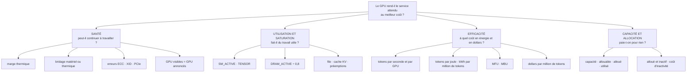
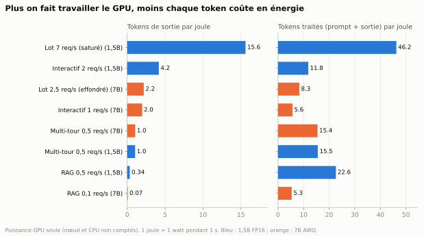

# 02 - Les KPI proposés : mesurer la santé, l'utilisation et l'efficacité du GPU

**En une phrase.** Un KPI est un chiffre choisi pour **décider quelque chose** : « dois-je remplacer ce nœud ? », « ai-je besoin d'un deuxième GPU ? », « cette configuration gaspille-t-elle de l'argent ? ».
Ce chapitre propose une vingtaine d'indicateurs, rangés en quatre familles, avec leur formule, un seuil de départ et la décision qu'ils guident.

<!-- mots: méthode use, marge, gpu_util, sm_active, mfu, goodput, slo -->
> **Mots à connaître**
> - **Méthode USE** : Pour chaque ressource, on regarde l'Utilisation (est-elle occupée ?), la Saturation (y a-t-il de la file ?) et les Erreurs.
> - **Marge (headroom)** : Ce qu'il reste avant une limite : degrés avant la limite thermique, watts avant le plafond de puissance.
> - **GPU_UTIL** : Part du temps où *au moins un* calcul tournait. **100 % ne veut pas dire saturé** (observé : le même GPU passe de 284 à 933 tokens/s à `GPU_UTIL` constant ou plus bas).
> - **SM_ACTIVE / TENSOR / DRAM_ACTIVE** : Compteurs plus fins : unités de calcul actives / tensor cores actifs / mémoire du GPU active.
> - **MFU / MBU** : Part du calcul (MFU) ou de la bande passante mémoire (MBU) réellement utilisée par rapport au maximum du GPU. Le MBU est le bon indicateur du décodage.
> - **Goodput** : Débit des requêtes **réussies et assez rapides** (qui respectent le SLO), pas le débit brut.
> - **SLO** : Un objectif chiffré de qualité de service, par exemple « 95 % des réponses commencent en moins de 5 s ».
> - Tous les mots : [glossaire](../sre/GLOSSAIRE.md).
<!-- /mots -->

Statuts : **existe** (déjà dans le dépôt avant ce dossier) · **nouveau** (ajouté, validé par des tests statiques, pas encore lu sur un cluster) · **nouveau + drapeau** (exige `--enable-mfu-metrics`, scénario `gpu-health`).
Les **seuils sont des valeurs de départ** : ils seront confirmés ou corrigés par la séance de mesures ([05](05-simulations.md)).

## 1. L'arbre des indicateurs

## 2. Famille SANTÉ : le GPU peut-il continuer ?

| KPI | Formule (règle du dépôt) | Seuil de départ | Décision qu'il guide | Statut |
|---|---|---|---|---|
| **Marge thermique** | limite de fonctionnement (85 °C **(forum)**) − température : `lab:gpu_thermal_headroom_celsius` | alerte sous **5 °C** pendant 5 min (`LabGPUThermalMarginLow`) ; l'alerte existante `LabGPUTemperatureHigh` reste à 85 °C | réduire la charge, répartir sur un 2e GPU, remplacer le nœud | nouveau |
| **Marge de puissance** | 70 W − puissance : `lab:gpu_power_headroom_watts` | information | savoir si l'on touche le plafond | nouveau |
| **Bridage matériel ou thermique** | 1 si un des bits 0x8, 0x20, 0x40, 0x80 est actif : `lab:gpu_throttle_hw_slowdown` | alerte après 5 min (`LabGPUThrottling`, comme AKS) | un nœud qui ralentit sans raison logicielle est suspect | nouveau (alerte refondue) |
| **Plafond de puissance logiciel** | bit 0x4 : `lab:gpu_throttle_sw_power_cap` | **aucune alerte** : fréquent sous forte charge, normal | comprendre pourquoi l'horloge est sous son maximum | nouveau |
| **Erreur ECC double** | `DCGM_FI_DEV_ECC_DBE_VOL_TOTAL` > 0 | alerte **critique** immédiate (`LabGPUEccUncorrectable`) | vider puis remplacer le nœud | nouveau |
| **Pages en attente de retrait** | `DCGM_FI_DEV_RETIRED_PENDING` = 1 | alerte après 5 min (`LabGPUPageRetirementPending`) | planifier un redémarrage | nouveau |
| **Code XID** | `DCGM_FI_DEV_XID_ERRORS` ≠ 0 | alerte critique (`LabGPUXidError`) | voir la table XID ([04](04-diagnostic-et-optimisation.md)) | existe |
| **Rejeux PCIe** | `increase(DCGM_FI_DEV_PCIE_REPLAY_COUNTER[10m])` > 0 | alerte (`LabGPUPcieReplays`) | lien instable : remplacer | nouveau |
| **Présence** | GPU annoncés par Kubernetes ≠ GPU vus par DCGM, 10 min | alerte (`LabGPUMissing`) | plugin, exporteur ou GPU en panne | nouveau |

### L'équivalent des contrôles de santé GPU d'AKS

AKS propose une surveillance de la santé des GPU (*Node Problem Detector*, doc Microsoft du 09/11/2026) qui **ne fonctionne pas sur les pools créés avec `--gpu-driver none`**, c'est-à-dire **notre configuration** (driver géré par le GPU Operator).
Ces contrôles n'existent donc pas sur notre cluster : on les reproduit avec Prometheus.

| Contrôle AKS (NPD) | Ce qu'il vérifie (doc Microsoft) | Notre équivalent |
|---|---|---|
| `GPUMissing` | le nombre de GPU vus par `nvidia-smi` égale le nombre attendu | `LabGPUMissing` (Kubernetes contre DCGM) |
| `GPUXIDErrors` | erreurs XID dans les journaux du noyau | `LabGPUXidError` (dernier code XID vu par DCGM) |
| `GPUClockThrottling` | signale `HW_SLOWDOWN`, `SW_THERMAL_SLOWDOWN`, `HW_THERMAL_SLOWDOWN`, `HW_POWER_BRAKE_SLOWDOWN` ; **ne signale pas** repos, absence de bridage, plafond de puissance configuré | `LabGPUThrottling` (mêmes bits) |
| `GPUECCError` | erreurs ECC SRAM et DRAM, remappages de lignes (Ampere et plus), pages retirées (V100) | `LabGPUEccUncorrectable`, `LabGPUPageRetirementPending` (sur T4 : retrait de pages) |
| `UnhealthyNvidiaDevicePlugin` | service du plugin GPU en bonne santé | panneau « DaemonSets du GPU Operator » (dashboard 07) ; pas d'alerte dédiée |
| `UnhealthyNvidiaDCGMServices` | services DCGM et exporteur actifs | `LabScrapeTargetMissing` (cible DCGM absente) |
| NVLink, InfiniBand, licence GRID | liens multi-GPU et licence | sans objet : un T4 par VM, pas de réseau InfiniBand |

Remarque (doc Microsoft) : NPD **ne remédie à rien** ; il publie des conditions. Chez nous aussi : les alertes préviennent, un humain décide (vider, redémarrer, remplacer).

## 3. Famille UTILISATION ET SATURATION : fait-il du travail utile ?

C'est la méthode USE ([README](README.md)) : pour chaque ressource, l'utilisation **et** la saturation.

| KPI | Formule | Lecture | Décision | Statut |
|---|---|---|---|---|
| **Calcul actif** | `DCGM_FI_PROF_SM_ACTIVE`, `PIPE_TENSOR_ACTIVE` | `SM_ACTIVE` ≥ 0,8 est nécessaire mais pas suffisant (doc DCGM) | savoir si le calcul est exploité | existe |
| **Mémoire active rapportée au maximum pratique** | `DRAM_ACTIVE ÷ 0,8` : `lab:gpu_dram_active_vs_practical_max` | proche de 1 = bande passante au maximum | le décodage est-il au bout de la mémoire ? | nouveau |
| **Saturation de file** | `lab:requests_waiting`, `lab:kv_cache_usage:max`, `lab:preemptions:rate5m` | file durable ou KV > 90 % = capacité dépassée | ajouter un réplica, réduire le contexte | existe |
| **Part du temps en prefill** | temps de prefill ÷ (prefill + decode) des requêtes | haut = charge RAG (calcul) ; bas = chat (mémoire) | choisir le levier (modèle, batch, découpage du prefill) | nouveau (panneau) |

**Ne jamais conclure sur un seul de ces chiffres.** Exemple observé : `GPU_UTIL` 100 % avec 40 % de la capacité ; `DRAM_ACTIVE` 0,70 en chat mais 0,15 en RAG alors que le GPU travaille dans les deux cas.

## 4. Famille EFFICACITÉ : à quel coût ?

| KPI | Formule | Valeurs observées (lab) | Statut |
|---|---|---|---|
| **Tokens par seconde et par GPU** | `lab:tokens_per_second_per_gpu` | 4 à 933 tokens/s selon la situation (130 à 284 en interactif) | existe |
| **Tokens par joule** | tokens de sortie ÷ joules : `lab:tokens_per_joule` | 0,07 à **15,6** tokens/J (tableau ci-dessous) | existe |
| **kWh par million de tokens** | `lab:gpu_kwh_per_million_tokens` = (10⁶ ÷ tokens/J) ÷ 3,6·10⁶ | 0,018 à 0,14 kWh (charges chat et lot) | nouveau |
| **Joules par requête** | puissance ÷ requêtes par seconde : `lab:gpu_energy_per_request_joules` | - | nouveau |
| **MBU** | (octets lus + écrits par seconde estimés par vLLM) ÷ 320 Go/s : `lab:gpu_mbu` | ≈ 83 % au décodage d'une requête (calcul, 7B AWQ) | nouveau + drapeau |
| **MFU** | opérations par seconde estimées par vLLM ÷ 65 TFLOPS : `lab:gpu_mfu` | non mesuré | nouveau + drapeau |
| **Dollars par million de tokens** | `lab:cost_per_million_tokens_usd` | 0,16 $ (lot 1,5B saturé) à 1,13 $ (7B interactif), GPU seul (calcul) | existe |
| **Goodput par GPU sous SLO** | requêtes bonnes par seconde ([SLO](../sre/SLO.md)) | voir SLO.md | existe |

Tableau équivalent de la figure (une mesure par ligne, puissance du GPU seule) :

| Modèle | Situation | Tokens de sortie par joule | Tokens traités (prompt + sortie) par joule |
|---|---|---|---|
| 1,5B FP16 | Lot 7 req/s (saturé) | **15,6** | 46,2 |
| 1,5B FP16 | Interactif 2 req/s | 4,2 | 11,8 |
| 7B AWQ | Lot 2,5 req/s (effondré) | 2,2 | 8,3 |
| 7B AWQ | Interactif 1 req/s | 2,0 | 5,6 |
| 7B AWQ | Multi-tour 0,5 req/s | 1,0 | 15,4 |
| 1,5B FP16 | Multi-tour 0,5 req/s | 1,0 | 15,5 |
| 1,5B FP16 | RAG 0,5 req/s | 0,34 | 22,6 |
| 7B AWQ | RAG 0,1 req/s | 0,07 | 5,3 |

**Lecture**
1. **Plus on fait travailler le GPU, moins chaque token coûte en énergie** : sur le 1,5B, de 4,2 à 15,6 tokens/J entre une charge interactive et une charge saturée (**× 3,7**). Un GPU peu chargé consomme encore une puissance de base (30,6 W à vide, observé).
2. **Pour le RAG, les « tokens de sortie par joule » sont trompeurs** (0,34 et 0,07) : presque tout le travail est du prefill, qu'on ne compte pas. La colonne « tokens traités » est plus juste (22,6 et 5,3).
3. **Sur Azure, l'énergie ne se paie pas** : le GPU est facturé **à l'heure** (0,526 $/h), pas au joule. Économiser des joules ne baisse pas la facture ; **augmenter les tokens produits par heure** la baisse (0,16 $ par million de tokens en lot saturé contre 0,52 $ en interactif sur le 1,5B). Les tokens par joule restent un bon indicateur d'**utilisation**, et le vrai KPI d'un datacenter qui paie son électricité.

## 5. Famille CAPACITÉ ET ALLOCATION : paie-t-on pour rien ?

| KPI | Formule | Décision | Statut |
|---|---|---|---|
| **Les quatre chiffres** | capacité, allouable, alloué, utilisé : `lab:gpu_capacity`, `lab:gpu_allocatable`, `lab:gpu_allocated`, `lab:gpu_used` | où se perd la capacité ? | existe |
| **GPU alloué et inactif** | alloué − utilisé : `lab:gpu_allocated_idle` | un GPU réservé mais sans trafic | nouveau |
| **Coût d'inactivité** | GPU alloués inactifs × 0,526 $/h : `lab:gpu_idle_cost_usd_per_hour` | arrêter ou réduire (alerte `LabGPUIdleCost` à 30 min ; 5 min dans le scénario `gpu-health`) | nouveau |
| **Écart entre GPU** | température maximale − minimale : `lab:gpu_temp_spread_celsius` | un GPU nettement plus chaud sous la même charge est suspect | nouveau |

## 6. Valeurs de référence sur ce T4 (à confirmer en séance)

| Grandeur | À vide (observé) | En charge (observé, 8 runs) | Limite |
|---|---|---|---|
| Puissance | 30,6 W | 50 à 68 W | 70 W (doc) |
| Horloge SM | 585 MHz | 1 006 à 1 383 MHz | 1 590 MHz (forum) |
| Température | 50 °C | 54 à 69 °C | 85 °C de fonctionnement (forum) |
| `SM_ACTIVE` | 0 | 0,48 à 0,97 | - |
| `DRAM_ACTIVE` | ≈ 0 | 0,08 à 0,70 | ≈ 0,8 pratique (doc) |

## 7. Les pièges de KPI

- **`GPU_UTIL` seul** : il ne dit pas si le GPU est saturé. L'utiliser avec `SM_ACTIVE` et la file.
- **Tokens par seconde « bruts »** : un lot saturé a un excellent débit et une latence inacceptable ; toujours le lire avec le **goodput** (requêtes qui tiennent le SLO).
- **Moyenne de température** : la marge se mesure au maximum, pas à la moyenne.
- **Comparer des KPI de configurations différentes** sans le même protocole de mesure ([module 1](../formation/01-mesurer-sans-se-tromper.md)).
- **Un KPI sans décision** : si personne ne sait quoi faire quand il change, ce n'est pas un KPI, c'est un graphique.

## 8. Exercice (à faire vous-même)

Objectif : choisir **le** KPI qui répond à chaque question, sans regarder les tableaux.
1. « Mon GPU me coûte 0,526 $/h : ai-je besoin d'un 2e ? » 2. « Ce nœud est-il en train de s'abîmer ? » 3. « Mon décodage exploite-t-il bien la mémoire ? »
Vérification : 1 = file d'attente + saturation + goodput ; 2 = erreurs ECC/XID, bridage matériel, marge thermique ; 3 = MBU (ou `DRAM_ACTIVE ÷ 0,8`).
