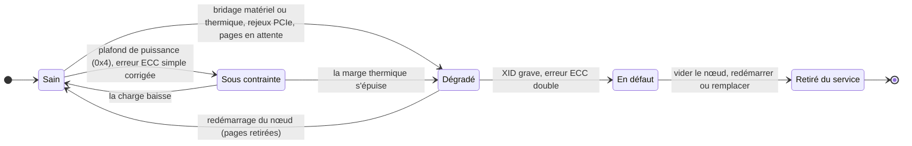
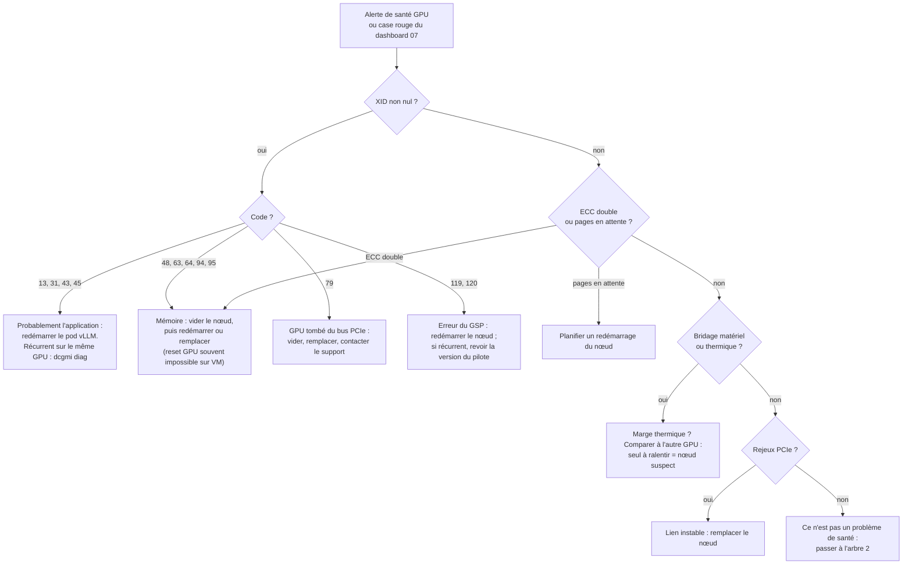
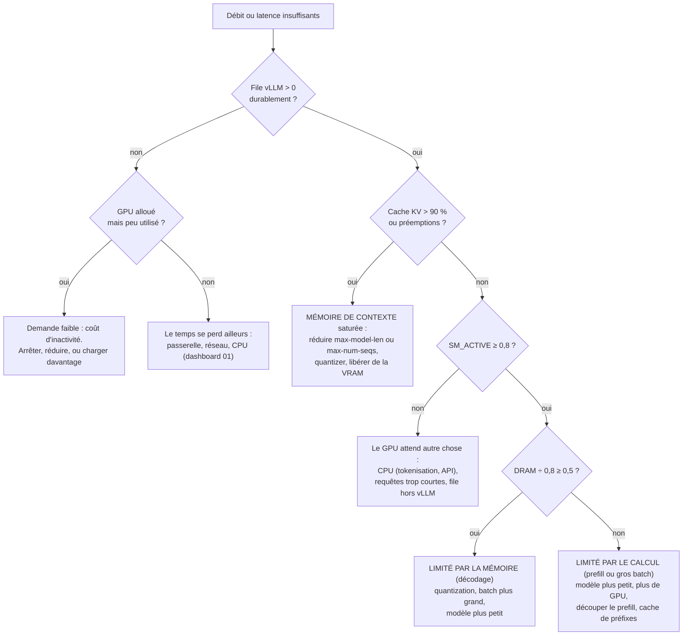

# 04 - Diagnostic et optimisation : de la mesure à l'action

**En une phrase.** Mesurer ne sert à rien si l'on ne sait pas quoi faire du chiffre. Ce chapitre donne trois outils de décision : **les états de santé d'un GPU**, **deux arbres de décision** (le GPU est-il malade ? pourquoi le débit est-il bas ?),
et un **tableau de leviers d'optimisation** chiffrés avec les preuves disponibles.

<!-- mots: xid, ecc, retrait de pages, raisons de bridage, méthode use, roofline, mbu, cold start -->
> **Mots à connaître**
> - **XID** : Code d'erreur NVIDIA signalant un problème GPU (ex. 79 : GPU tombé du bus).
> - **ECC / SBE / DBE** : Code qui détecte et corrige les erreurs de la mémoire du GPU. SBE = erreur simple, corrigée ; DBE = erreur double, non corrigeable (grave).
> - **Retrait de pages (page retirement)** : Sur les GPU avant l'A100 (dont le T4), une zone mémoire défaillante est mise de côté définitivement ; le retrait prend effet au redémarrage.
> - **Raisons de bridage (clock event reasons)** : Les causes qui font baisser l'horloge : repos, plafond de puissance, ralentissement thermique ou matériel... Un masque de bits (`DCGM_FI_DEV_CLOCK_THROTTLE_REASONS`) à décoder.
> - **Méthode USE** : Pour chaque ressource, on regarde l'Utilisation (est-elle occupée ?), la Saturation (y a-t-il de la file ?) et les Erreurs.
> - **Roofline** : Graphique qui dit si un calcul est limité par la mémoire ou par le calcul, selon le nombre d'opérations faites par octet lu.
> - **MFU / MBU** : Part du calcul (MFU) ou de la bande passante mémoire (MBU) réellement utilisée par rapport au maximum du GPU. Le MBU est le bon indicateur du décodage.
> - **Cold start** : Délai entre « on demande un GPU / un pod » et « il répond ». Ici : **721 s** pour un nœud GPU, **~3,5 min** pour changer de modèle (observé).
> - Tous les mots : [glossaire](../sre/GLOSSAIRE.md).
<!-- /mots -->

Marques : **(doc)** documentation officielle · **(observé)** vu sur le cluster · **(calcul)** · **(papier)** résultat d'un article de recherche, non reproduit ici · **(non vérifié)**.

## 1. Les états de santé d'un GPU

| État | Signaux typiques | Conduite |
|---|---|---|
| **Sain** | tout vert sur la première ligne du dashboard 07 | rien |
| **Sous contrainte** | plafond de puissance logiciel (bit 0x4), horloge sous le maximum, erreurs ECC simples isolées | **normal** sous forte charge ; surveiller |
| **Dégradé** | bridage matériel ou thermique, marge thermique basse, rejeux PCIe, pages en attente de retrait | prévoir une intervention (redémarrage, comparaison avec l'autre GPU) |
| **En défaut** | XID grave (48, 79, 95, 119, 120), ECC double | **vider le nœud** ; ne pas ignorer |
| **Retiré** | nœud vidé | remplacer ; diagnostic avant remise en service |

## 2. Arbre 1 : « le GPU est-il malade ? »

### La table XID (catalogue officiel NVIDIA)

| XID | Nom officiel | Cause probable (doc) | Action NVIDIA | Notre lecture sur AKS (VM Azure) |
|---|---|---|---|---|
| **13** | Graphics Engine Exception | faute de l'application (accès hors limites) ; rarement matériel | redémarrer l'application ; sinon outils de débogage | redémarrer le pod vLLM ; si récurrent sur le même GPU : `dcgmi diag` |
| **31** | GPU memory page fault | le plus souvent un bogue d'application ; parfois pilote ou matériel | redémarrer l'application ; répété sur le même GPU : diagnostics matériel | idem ; comparer avec l'autre GPU |
| **43** | GPU stopped processing | faute logicielle de l'application, « pas un bogue de pilote dans la plupart des cas » | ignorer, le GPU reste sain | surveiller, ne pas agir |
| **45** | Preemptive cleanup | l'application a été arrêtée (Ctrl-C, reset, SIGKILL) | informatif ; suivre l'autre XID | chercher l'erreur qui précède |
| **48** | Double Bit ECC Error | erreur mémoire non corrigeable | seul : réinitialiser le GPU ; suivi de 63/64 : **vider puis réinitialiser** | vider puis redémarrer ou remplacer le nœud |
| **63** | GPU memory remapping event | avant l'A100 : **retrait de pages** (le cas du T4) ; à partir de l'A100 : remappage de lignes | ignorer (avec 48 : vider et réinitialiser) | planifier un redémarrage |
| **64** | GPU memory remapping failure | le retrait ou remappage a échoué | **réinitialiser le GPU**, contacter le support | remplacer le nœud |
| **79** | GPU has fallen off the bus | lien PCIe défaillant, matériel ou pilote | redémarrer la machine, contacter le support ; drainer | **vider et remplacer** le nœud |
| **94** | Contained memory error | erreur mémoire contenue : seule l'application touchée est affectée | redémarrer l'application | redémarrer le pod ; réinitialiser « quand c'est commode » |
| **95** | Uncontained memory error | erreur mémoire non contenue | **réinitialiser le GPU avant de relancer** | vider, redémarrer le nœud |
| **119 / 120** | GSP RPC Timeout / GSP Error | erreur du processeur de contrôle du GPU (GSP) | réinitialiser le GPU ; si persistant, redémarrer la machine | redémarrer le nœud ; revoir la version du pilote si récurrent |

Notes officielles utiles : un **reset de GPU** exige les droits root et qu'aucune application n'utilise le GPU ; **sur une VM il est souvent non supporté** : on redémarre la VM (guide de triage NVIDIA).
L'ordre recommandé : identifier le XID → appliquer l'action → **diagnostics DCGM** (`dcgmi diag -r 3` : environ 30 minutes d'après le guide de triage, moins de 10 minutes pour 4 GPU Hopper d'après la doc DCGM ; **mesuré sur notre T4, GPU libre : 5 min 48 s**, [07 §8](07-resultats-seance.md#8-dcgm-autonome-et-santé) ; à lancer **sans** vLLM sur le GPU) → diagnostics matériel → rapport au fournisseur.
Format dans le journal du noyau : `NVRM: Xid (0000:03:00): 14, ...` (doc). Le lab expose le **dernier** code via `DCGM_FI_DEV_XID_ERRORS`.

## 3. Arbre 2 : « pourquoi le débit est-il bas ? »

**Seuils provisoires.** Le seuil `DRAM ÷ 0,8 ≥ 0,5` sépare, parmi nos huit situations mesurées, les situations de chat (0,64 à 0,88) de celles de lot et de RAG (0,19 à 0,34) ; le multi-tour du 1,5B (0,54) est à la frontière.
Ces valeurs viennent d'**une mesure par situation** : la séance GPU ([05](05-simulations.md)) les confirme ou les corrige.

## 4. Les leviers d'optimisation, avec leurs preuves

| Levier | Signal qui le justifie | Effet attendu | Preuve disponible | Risque et coût |
|---|---|---|---|---|
| **Plus de requêtes en parallèle (batch)** | décodage limité par la mémoire, `SM_ACTIVE` pas saturé | plus de tokens/s : les poids sont lus une fois pour tout le groupe | **observé** : le 1,5B passe de 284 à 933 tokens/s en régime saturé | latence : TTFT p50 de 39 s en lot saturé |
| **Quantization 4 bits (AWQ)** | VRAM serrée, décodage mémoire | moins d'octets à lire par token | **observé** : le 7B tient en 5,29 Gio ; décodage à ≈ 83 % du toit mémoire ; plus d'activité tensor | qualité à mesurer ; effet sur le débit non mesuré (expérience M1) |
| **Découper le prefill** (`max-num-batched-tokens`) | un prefill long ralentit les autres requêtes | lisser la latence inter-token | **observé** : TPOT de 0,020 s à 0,20 s avec du RAG (1,5B) | à mesurer ; compromis TTFT / TPOT |
| **Réplica supplémentaire (KEDA)** | file durable, GPU saturé | + capacité | **observé** (BASELINE §7) : 2e pod prêt 6 min 51 s après la décision | coût × 2 ; démarrage de nœud 721 s |
| **Fréquence ou puissance du GPU** | énergie par token élevée, GPU près du plafond | moins d'énergie à débit presque égal | **(papier)** GreenLLM : jusqu'à **34 %** d'énergie en moins en réglant la fréquence par phase (prefill / decode) ; VoltanaLLM : baisser les horloges ne réduit pas toujours l'énergie | **observé sur notre T4** : `-pl 60` + 10 % de tokens par joule pour − 6,5 % de débit ; verrouillage à 900 MHz + 21 % pour − 8 % ; à 750 MHz le gain disparaît ; **non refusé par Azure** ; latence plus haute au bord de la capacité ([07 §6](07-resultats-seance.md#6-limite-de-puissance-et-verrouillage-dhorloge)) ; sur Azure l'énergie ne se paie pas ([02](02-kpi.md)), c'est un choix de capacité |
| **Mémoire du cache KV** (`gpu-memory-utilization`) | préemptions, KV à 100 % | plus de contexte simultané | **observé** : 113 760 à 130 512 tokens de KV selon le déploiement | trop haut = mémoire insuffisante au démarrage |
| **Cache de préfixes** | multi-tour, RAG avec préfixe commun | TTFT divisé par ≈ 4,5 | **observé** : TTFT p50 de 0,63 s à 0,14 s sur le profil à préfixes partagés (7B, 1 req/s) | inutile sans préfixe commun |
| **Arrêter ou réduire le GPU inactif** | GPU alloué et inactif | économiser 0,526 $/h par T4 | **observé** : T4 à 30,6 W à vide, facturé pareil | redémarrage : 12 min pour un nœud, 3,5 min pour un modèle |
| **Modèle plus petit pour le RAG et le lot** | le 7B s'effondre au-delà de 2 req/s | tenir la charge | **observé** : le 1,5B absorbe 7 req/s ; le 7B s'effondre à 2,5 req/s | qualité |

### Ce que disent les articles de recherche (résumés, non reproduits ici)

- **GreenLLM** (arXiv 2508.16449) : le prefill (calcul) et le decode (mémoire) n'ont pas la même fréquence idéale ; régler la fréquence par phase réduit l'énergie jusqu'à 34 % par rapport à la gestion par défaut, avec moins de 3,5 % de violations de SLO en plus (rejeu de traces Alibaba et Azure).
- **VoltanaLLM** (arXiv 2509.04827) : baisser les horloges ne réduit pas toujours l'énergie, car la durée augmente quand la puissance baisse.
- **RAPID** (arXiv 2601.12241) : à budget de puissance fixe, donner plus de puissance aux GPU de prefill qu'à ceux de decode.
- **HALO** (CEUR vol. 4275) : un balayage de calibration trouve une plage de fréquences efficace ; réduction de 39,4 % de l'énergie GPU sur le modèle principal de l'étude.
Ces chiffres viennent des articles et n'ont pas été vérifiés ; ils justifient un **balayage d'horloge sur le T4** (séance GPU, expérience S5), pas une conclusion.

## 5. À retenir

1. **Santé et efficacité sont deux questions séparées** : un GPU peut être sain et mal utilisé, ou utilisé à fond et malade. Deux arbres, deux dashboards.
2. **Sur une VM, on ne répare pas un GPU : on vide, on redémarre, on remplace le nœud** (le reset de GPU est souvent non supporté).
3. **Le levier dépend du goulot** : mémoire (quantization, batch, modèle plus petit), calcul (modèle plus petit, GPU en plus, découpage du prefill), mémoire de contexte (KV).

## 6. Exercice (à faire vous-même)

Objectif : décider sans aide. Situation : file vLLM durablement > 0, cache KV à 35 %, `SM_ACTIVE` 0,97, `DRAM_ACTIVE` 0,22, une seule requête sur dix a un prompt long.
1. Parcourez l'arbre 2 : quel est le goulot ? 2. Citez deux leviers de la table et un risque pour chacun. 3. Quelle mesure supplémentaire confirmerait votre diagnostic ?
Vérification : `DRAM ÷ 0,8` = 0,275 < 0,5 donc **limité par le calcul** (comme le lot saturé du lab) ; leviers : modèle plus petit (qualité), réplica en plus (coût et 721 s de démarrage) ; mesure : la **part du temps en prefill** et le **MFU**.
