# 05 - La séance « santé et mesures du GPU » : simulations sur les T4 du lab

**En une phrase.** On allume le cluster, on **observe le GPU au repos, sous charge croissante, sous charge soutenue, avec des charges de prefill pur et de decode pur**, on **provoque des situations** (horloge verrouillée, GPU inactif, alerte déclenchée) et on vérifie que les dashboards,
les KPI et les alertes de ce dossier disent la vérité.

<!-- mots: nvidia-smi, horloge, raisons de bridage, dcgm, dcgm hostengine, xid, throttling, mbu -->
> **Mots à connaître**
> - **nvidia-smi** : Commande NVIDIA qui affiche l'état du GPU : température, puissance, horloges, mémoire, erreurs.
> - **Horloge (clock)** : Fréquence de travail du GPU, en MHz (≈ 585 au repos sur le T4, 1 590 au maximum d'après un relevé publié sur le forum NVIDIA). Elle baisse quand le GPU est bridé.
> - **Raisons de bridage (clock event reasons)** : Les causes qui font baisser l'horloge : repos, plafond de puissance, ralentissement thermique ou matériel... Un masque de bits (`DCGM_FI_DEV_CLOCK_THROTTLE_REASONS`) à décoder.
> - **DCGM** : Outil NVIDIA qui mesure le GPU ; `dcgm-exporter` publie ces mesures pour Prometheus.
> - **DCGM hostengine** : Le processus DCGM qui collecte les mesures du GPU ; l'exporteur peut l'embarquer ou se connecter à un hostengine séparé (doc DCGM).
> - **XID** : Code d'erreur NVIDIA signalant un problème GPU (ex. 79 : GPU tombé du bus).
> - **Throttling / limite de puissance** : Le GPU baisse sa fréquence quand il atteint sa limite (70 W sur T4).
> - **MFU / MBU** : Part du calcul (MFU) ou de la bande passante mémoire (MBU) réellement utilisée par rapport au maximum du GPU. Le MBU est le bon indicateur du décodage.
> - Tous les mots : [glossaire](../sre/GLOSSAIRE.md).
<!-- /mots -->

**Statut : préparée, pas encore exécutée.** Tout ce qui est décrit ici a été préparé dans le dépôt (scénarios, profils, scripts, règles) et validé par des tests statiques ; rien n'a été lancé sur un cluster. Les durées sont des **estimations** (calcul) bâties sur ce qui a été mesuré : cluster prêt en ≈ 19 min, nœud GPU prêt en 12 min, changement de modèle en 3,5 min, un run de charge en ≈ 8 min.

## 1. Ce que la séance doit prouver

| # | Question | Pourquoi c'est important |
|---|---|---|
| 1 | Quelles sont les **vraies limites** de notre T4 (température, puissance, horloges) ? | les seuils actuels viennent d'un forum, pas de notre GPU |
| 2 | Pourquoi l'horloge reste-t-elle sous le maximum ? **Quelle raison de bridage** est active ? | on le soupçonne (plafond de puissance), on ne l'a pas relevé |
| 3 | Que valent `SM_ACTIVE`, `TENSOR`, `DRAM_ACTIVE`, le MBU en **prefill pur** et en **decode pur** ? | la fiche « lire un GPU » n'a que des mélanges |
| 4 | Le GPU chauffe-t-il jusqu'à brider sous charge **soutenue** ? | nos runs durent 5 minutes |
| 5 | Existe-t-il une **fréquence** plus efficace en énergie par token ? | piste de la littérature (jusqu'à − 34 %), jamais testée sur T4 |
| 6 | Deux T4 sous la même charge se **ressemblent-ils** ? | savoir repérer un GPU « différent » |
| 7 | Les **alertes** de santé et d'inactivité arrivent-elles jusqu'au récepteur ? | validées par promtool, jamais sur un cluster |
| 8 | Que donnent les **diagnostics DCGM** sur un T4 ? | outil de référence de NVIDIA pour la santé d'un GPU |

## 2. Les expériences

| Id | Expérience | Question | Durée (cluster) | Parcours |
|---|---|---|---|---|
| **S0** | Démarrage et relevé statique | 1 | 30 min | court et complet |
| **S1** | Repos (idle) | 2 | 10 min | court et complet |
| **S4** | Prefill pur contre decode pur | 3 | 30 min | court et complet |
| **S2** | Escalier de charge | 2, 3 | 40 min | court et complet |
| **S3** | Charge soutenue | 4 | 40 min | complet |
| **S5** | Balayage d'horloge (si Azure l'autorise) | 5 | 60 min | complet |
| **S7** | GPU alloué mais inactif (alerte) | 7 | 12 min | court et complet |
| **S6** | Comparer deux T4 | 6 | 45 min | complet |
| **S8** | Santé DCGM (`dcgmi health` et `diag`) | 8 | 30 min | court et complet |
| **S9** | Injection d'un XID (test du chemin d'alerte) | 7 | 10 min | court et complet |

**Parcours court** : S0, S1, S4, S2, S7, S8, S9 ≈ **3 h** de cluster (1 T4), soit **≈ 2,1 $** (0,708 $/h).
**Parcours complet** : + S3, S5, S6 ≈ **5,5 h** (dont 1 h avec 2 T4), soit **≈ 4,4 $** (calcul, à ± 10 %). Le cluster est détruit à la fin ; les docs se rédigent ensuite, sans coût.

```mermaid
gantt
  title Séance GPU, parcours complet (heures et minutes depuis le démarrage)
  dateFormat HH:mm
  axisFormat %H:%M
  section Mise en route
  Démarrage et S0 relevé statique   :s0, 00:00, 30m
  section Mesures sur 1 T4
  S1 repos                          :s1, after s0, 10m
  S4 prefill pur et decode pur      :s4, after s1, 30m
  S2 escalier de charge             :s2, after s4, 40m
  S3 charge soutenue                :s3, after s2, 40m
  S5 balayage d'horloge             :s5, after s3, 60m
  S7 GPU inactif et alerte          :s7, after s5, 12m
  section Avec 2 T4
  S6 comparer deux GPU              :s6, after s7, 45m
  section Santé
  S8 diagnostics DCGM               :s8, after s6, 30m
  S9 injection XID                  :s9, after s8, 10m
```

## 3. Le détail de chaque expérience

### S0 - Démarrage et relevé statique

- **Comment** : avant le démarrage, écrire `scenario: gpu-health` dans `gitops/active-azure.yaml`, commit et push (`lab.sh scenario` exige un cluster qui tourne, il ne sert qu'après `up`), puis `./lab.sh up` (le scénario active `--enable-mfu-metrics`). Quand le modèle sert : `tests/gpu_snapshot.sh statique`.
- **Relever** (sortie de `nvidia-smi -q -d TEMPERATURE,POWER,CLOCK,PERFORMANCE,ECC,PAGE_RETIREMENT`) : *Max Operating Temp*, *Slowdown Temp*, *Shutdown Temp*, *Min/Max Power Limit*, horloges maximales, mode ECC, pages retirées, lien PCIe.
- **Vérifier** : les 9 nouveaux champs DCGM apparaissent-ils sur `:9400/metrics` ? Quelle est l'unité réelle de `DCGM_FI_DEV_POWER_VIOLATION` (comparer la hausse du compteur au temps écoulé) ? Les métriques `vllm:estimated_*` existent-elles avec le drapeau ?
- **Critère de réussite** : chaque valeur « (forum) » de [01](01-signaux-du-gpu.md) est confirmée ou corrigée, et `gpuLimits` (`values.yaml`) mis à jour si besoin.
- **Risque** : un champ DCGM non supporté par le T4 est absent : on le note, on n'insiste pas.

### S1 - Repos

- **Comment** : modèle chargé, aucune requête, `tests/gpu_snapshot.sh repos 600` (enregistrement à 1 Hz pendant 10 min).
- **Attendu** : ≈ 30,6 W, 585 MHz, ≈ 50 °C, `GPU_UTIL` 0 ; **masque de bridage = 0x1** (repos). Les règles `lab:gpu_throttle_*` doivent valoir 0.
- **Critère** : seul le bit « repos » est actif.

### S4 - Prefill pur contre decode pur

- **Comment** : `RATE=… WARMUP=60 DURATION=300 ./lab.sh bench prefill-only`, puis `decode-only` (profils ajoutés : prompts de 1 500 à 3 000 tokens et 1 à 4 tokens de sortie ; prompts de 16 à 64 tokens et 384 à 512 tokens de sortie). Débits à choisir pour occuper le GPU sans faire de file (vérifier `requests_waiting` = 0).
- **Relever** : `SM_ACTIVE`, `TENSOR`, `DRAM_ACTIVE`, puissance, horloge, MBU, part de prefill (`tests/run_window.py`).
- **Critère** : `DRAM ÷ 0,8` ≥ 0,5 en decode pur et < 0,5 en prefill pur (les seuils provisoires de l'arbre 2 de [04](04-diagnostic-et-optimisation.md)) ; sinon on corrige les seuils.
- **Hypothèse à tester** : les tensor cores travaillent plus en decode AWQ qu'en prefill (les observations actuelles vont dans ce sens, sans l'isoler).

### S2 - Escalier de charge

- **Comment** : `SWEEP_RATES="0.25,0.5,1,1.5,2,2.5" STAGE_DURATION=240 PER_REQUEST=true ./lab.sh bench sweep` avec, en parallèle, `tests/gpu_snapshot.sh escalier 1500`.
- **Relever par palier** : tokens/s, TTFT/TPOT, `GPU_UTIL`, `SM_ACTIVE`, `DRAM ÷ 0,8`, puissance, horloge, température, **masque de bridage**, MBU, tokens par joule.
- **Critère** : on trace puissance et horloge en fonction du débit ; on repère le palier où la puissance atteint le plafond et celui où la file apparaît ; le plafond est atteint **avant ou après** la saturation de file ?
- **À écrire pendant la préparation** : un petit script qui découpe les enregistrements par palier (les fenêtres de temps sont dans les annotations Grafana).

### S3 - Charge soutenue

- **Comment** : 7B à environ 80 % du plateau (≈ 1,4 req/s) pendant 40 minutes, `tests/gpu_snapshot.sh soutenu 2400`.
- **Relever** : température au cours du temps (constante de temps de montée), horloge, puissance, apparition d'un bit de bridage.
- **Critère** : la température se stabilise en dessous de la limite (observé jusqu'ici : 69 °C au maximum sur 5 minutes) ; aucune alerte de santé.

### S5 - Balayage d'horloge (si l'environnement l'autorise)

- **Question** : y a-t-il une fréquence qui réduit les joules par token sans dégrader la latence ?
- **Comment** : dans le conteneur du pilote, `nvidia-smi -lgc 900,900` (puis 1100, 1300, 1500, 1590), le verrouillage d'horloge étant documenté comme pris en charge à partir de Volta et demandant root ; pour **chacune** des cinq fréquences, une charge `decode-only` et une charge `prefill-only` à débit fixe, 5 minutes chacune. Restaurer ensuite (`nvidia-smi -rgc`, **à vérifier** avec `nvidia-smi --help`).
- **Relever** : tokens/s, TPOT, TTFT, puissance, **tokens par joule**.
- **Critère** : une courbe énergie par token en fonction de la fréquence ; le genou (littérature : courbes en U avec des genoux différents pour prefill et decode) existe-t-il sur T4 ?
- **Risques** : le verrouillage peut être refusé sur une VM Azure ; dans ce cas on essaie `nvidia-smi -pl` (limite de puissance, valeur entre le minimum et le maximum affichés), et si cela échoue aussi **on abandonne cette expérience** et on le consigne. Aucune source consultée ne confirme que `-pl` fonctionne sur T4.

### S7 - GPU alloué mais inactif

- **Comment** : modèle chargé, aucun trafic pendant au moins **12 minutes** (le scénario `gpu-health` ramène le seuil de l'alerte de 30 à 5 minutes : 5 minutes de moyenne basse puis 5 minutes de maintien).
- **Vérifier** : `lab:gpu_allocated_idle` = 1 ; `lab:gpu_idle_cost_usd_per_hour` = 0,526 ; l'alerte `LabGPUIdleCost` est reçue par le récepteur d'alertes ; elle disparaît quand on renvoie du trafic.
- **Critère** : le chemin règle → Prometheus → Alertmanager → récepteur est prouvé (comme pour `LabSLOBurnSlow`).

### S6 - Comparer deux T4

- **Comment** : `./lab.sh gpu-scale 2` (nœud prêt en ≈ 12 min), 2 réplicas, charge égale (le routeur EPP répartit), 20 minutes.
- **Relever** : température, puissance, horloge et joules par token **par GPU** ; `lab:gpu_temp_spread_celsius`.
- **Critère** : écart de température et d'énergie par token entre les deux GPU ; proposition de seuil « GPU différent » (provisoire : plus de 5 °C d'écart durable ou plus de 10 % d'énergie par token).
- **Risque** : capacité T4 insuffisante pour le 2e nœud malgré le quota (déjà signalée par la communauté en 2026) ; on retomberait sur le parcours court.

### S8 - Santé DCGM

- **Étape 0 (gratuite, avant)** : vérifier si `dcgmi` est disponible sur le cluster. L'exporteur du GPU Operator est une image minimale sans `dcgmi` ; il faut probablement activer le DCGM autonome du GPU Operator (réglage `dcgm.enabled`, **à vérifier** dans la doc du GPU Operator 26.7). Ce changement est à faire par Git avant la séance.
- **Comment** : `dcgmi discovery -l` ; `dcgmi health -s a` puis `dcgmi health -c` (surveillance PCIe, mémoire, thermique et puissance, pilote...) ; `dcgmi diag -r 1` (secondes). Pour `-r 2` et `-r 3`, **libérer le GPU** : `./lab.sh scenario gpu-health-diag` (aucun réplica ; la doc DCGM précise que le test de déploiement échoue si un autre processus utilise le GPU).
- **Relever** : résultats (réussite, échec), **durée réelle** sur T4 (la doc donne moins de 2,5 min pour `-r 2` et moins de 10 min pour `-r 3` sur 4 GPU Hopper ; le guide de triage dit environ 30 minutes), puissance et température atteintes pendant les tests « targeted power » et « targeted stress ».
- **Critère** : le diagnostic réussit sur un GPU sain ; on garde les durées et la sortie comme **référence de comparaison** pour un futur nœud suspect.

### S9 - Injection d'un XID (test du chemin d'alerte)

- **Principe** : DCGM permet d'**injecter une valeur** dans un champ pour tester les politiques et les alertes sans panne réelle : `dcgmi test --inject --gpuid 0 -f 230 -v 79` simule un XID 79 (champ 230 = `DCGM_FI_DEV_XID_ERRORS`).
- **Précautions (doc NVIDIA et guide EKS)** : réservé à un hôte de test isolé ; **la valeur injectée persiste jusqu'au remplacement du nœud** et ne peut pas être annulée. Notre cluster est jetable et détruit à la fin : on le fait **en dernier**.
- **Vérifier** : `DCGM_FI_DEV_XID_ERRORS` = 79 dans Prometheus, `LabGPUXidError` passe en `firing`, le récepteur reçoit l'alerte.
- **Condition à vérifier avant** : l'exporteur doit lire le **même** hostengine que celui où l'on injecte (DCGM autonome partagé). Sinon l'injection n'est pas visible : on le consigne et le test d'alerte reste couvert par promtool.

### S10 - Analyse (sans cluster)

Tableau « efficacité par situation » (tokens/s, watts, tokens par joule, MBU, coût), courbes de S2, S3, S5, comparaison de S6 ; mise à jour de [01](01-signaux-du-gpu.md), [02](02-kpi.md) et du module 5 de la formation avec les **valeurs confirmées**.

## 4. Ce qu'on ne fait pas, et pourquoi

| Sujet | Décision | Raison |
|---|---|---|
| Remplacement de nœud sous trafic, montée de driver, mise à jour d'image de nœud, partage de GPU (time-slicing, MPS), colocation chat + embeddings | **non retenus** | demande du propriétaire du lab : opérations d'infrastructure, hors du sujet « lire et optimiser le GPU » |
| Panne matérielle réelle (ECC, XID) | impossible | on ne peut pas abîmer volontairement un GPU ; on lit les compteurs et on **injecte** des valeurs (S9) |
| MIG | impossible | il n'existe pas sur le T4 |
| **NVSentinel** (détection de pannes GPU de NVIDIA) | **non déployé, étudié** | trois obstacles ci-dessous |

**Pourquoi NVSentinel n'est pas dans la séance** (README officiel du projet, lu le 17/11) :

1. **Architectures validées : Volta, Ampere, Hopper, Ada Lovelace, Blackwell.** Le T4 (Turing) n'y figure pas : le support n'est pas garanti.
2. **cert-manager v1.21 ou plus** exigé ; le lab est épinglé en **v1.17.4** par KServe v0.21.0. Monter cert-manager risque de casser KServe.
3. **GPU Operator avec `dcgm.enabled=true`** (NVSentinel se connecte directement à DCGM), **Kubernetes 1.34+** (notre AKS 1.34 convient) et **un stockage persistant pour une base MongoDB** (un composant de plus à héberger).
Par défaut l'installation est **en observation seule** (elle ne vide ni ne redémarre rien) : c'est ce qu'on voulait. À reprendre sur un cluster dédié, avec un GPU supporté, ou quand les versions de cert-manager le permettront.
**En remplacement**, ce dossier reproduit les contrôles de santé GPU d'AKS avec Prometheus ([02](02-kpi.md)), ce qui démontre la même compétence : détecter un GPU malade sans intervention humaine, sans remédiation automatique.

## 5. Préparation (gratuite) et vérifications avant la séance

| À faire | État |
|---|---|
| Scénarios `gpu-health` (MFU activé, seuil d'inactivité à 5 min) et `gpu-health-diag` (aucun réplica) | fait |
| Profils `prefill-only` et `decode-only` | fait |
| Dashboards 07 et 08, 14 règles KPI, 5 nouvelles alertes et l'alerte de bridage refondue, 5 runbooks | fait (validé statiquement) |
| Scripts `tests/gpu_snapshot.sh` et `tests/run_window.py` | fait (`gpu_snapshot.sh` non testé sur cluster) |
| Script de découpage par palier (S2) | à faire |
| Vérifier dans la doc du GPU Operator 26.7 : activation du DCGM autonome (`dcgm.enabled`) et connexion de l'exporteur | à faire (S8, S9) |
| Vérifier avec `nvidia-smi --help` : `-rgc`, `-ac`, `-pl` | à faire (S5) |
| Mesurer l'effet du drapeau `--enable-mfu-metrics` sur le débit (comparer à `baseline-7b`) | à faire en S2 |

## 6. À retenir

1. La séance répond à **huit questions précises** ; chaque expérience a un critère de réussite écrit **avant** le run.
2. Tout ce qui est « (forum) » dans ce dossier est **remplacé par une mesure** en S0.
3. On provoque des situations **sans abîmer le matériel** : horloge verrouillée, GPU laissé inactif, valeur d'erreur injectée.

## 7. Exercice (à faire vous-même)

Objectif : écrire le critère de réussite de **S3** (charge soutenue) à la place de moi, sans relire le texte.
1. Quelle grandeur fixez-vous pour dire « la température s'est stabilisée » ? 2. Quel masque de bridage est acceptable, et lequel déclenche un arrêt de l'expérience ?
Vérification : une variation de température inférieure à environ 1 °C sur 10 minutes ; acceptables : 0x1 (repos) et 0x4 (plafond logiciel) ; tout bit 0x8, 0x20, 0x40 ou 0x80 = arrêt et relevé.
