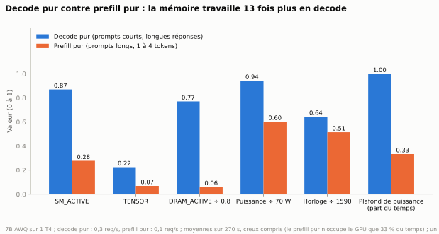
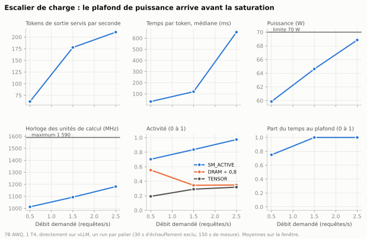
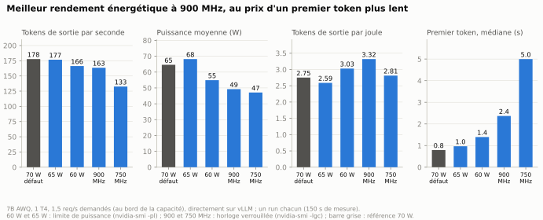

# 07 - Résultats de la séance GPU du 17/11/2026

**En une phrase.** Ce chapitre rassemble **tout ce qui a été mesuré** sur le vrai T4 d'AKS pendant la séance GPU : les limites réelles du matériel, le comportement sous charge, l'effet d'une limite de puissance, le test des alertes et celui de DCGM. Chaque chiffre vient d'un fichier du dépôt (section « Où sont les données »).

<!-- mots: nvidia-smi, horloge, raisons de bridage, plafond de puissance, limite de puissance, verrouillage d'horloge, tokens par joule, dcgmi, xid, mfu, roofline -->
> **Mots à connaître**
> - **nvidia-smi** : Commande NVIDIA qui affiche l'état du GPU : température, puissance, horloges, mémoire, erreurs.
> - **Horloge (clock)** : Fréquence de travail du GPU, en MHz (≈ 585 au repos sur le T4, 1 590 au maximum, relevé par `nvidia-smi -q` sur notre GPU). Elle baisse quand le GPU est bridé.
> - **Raisons de bridage (clock event reasons)** : Les causes qui font baisser l'horloge : repos, plafond de puissance, ralentissement thermique ou matériel... Un masque de bits (`DCGM_FI_DEV_CLOCK_THROTTLE_REASONS`) à décoder.
> - **Plafond de puissance (SW power cap)** : Le GPU baisse **lui-même** son horloge pour rester sous sa limite de puissance. C'est le bit `0x4` du masque de bridage : **normal** sous forte charge.
> - **Throttling / limite de puissance** : Watts maximum que le GPU peut consommer : 70 W par défaut sur notre T4, réglable de 60 à 70 W (`nvidia-smi -pl`). Quand il l'atteint, le GPU baisse sa fréquence (throttling).
> - **Verrouillage d'horloge** : Fixer la fréquence du GPU (`nvidia-smi -lgc min,max`) ; `-rgc` rend la main au GPU. Sert à mesurer l'énergie par token à chaque fréquence.
> - **Tokens par joule** : Tokens produits pour chaque joule consommé (= tokens par seconde ÷ watts). Mesure d'efficacité énergétique.
> - **dcgmi** : Commande de DCGM : état de santé (`dcgmi health`), diagnostics (`dcgmi diag -r 1/2/3`), injection d'erreurs de test (`dcgmi test --inject`).
> - **XID** : Code d'erreur NVIDIA signalant un problème GPU (ex. 79 : GPU tombé du bus).
> - **MFU / MBU** : Part du calcul (MFU) ou de la bande passante mémoire (MBU) réellement utilisée par rapport au maximum du GPU. Le MBU est le bon indicateur du décodage.
> - **Roofline** : Graphique qui dit si un calcul est limité par la mémoire ou par le calcul, selon le nombre d'opérations faites par octet lu.
> - Tous les mots : [glossaire](../sre/GLOSSAIRE.md).
<!-- /mots -->

Marques de fiabilité : **(observé)** vu sur le cluster · **(doc)** documentation officielle · **(calcul)** déduit d'un calcul · **(non élucidé)** constaté sans explication établie.

## 1. Ce qui a été fait, et ce qui ne l'a pas été

| Expérience | Statut | Où lire le résultat |
|---|---|---|
| **S0** Relevé statique (`nvidia-smi -q`, topologie, horloges, ECC, pages retirées) | **faite** | [§2](#2-les-vraies-limites-du-t4-confirmées) |
| **S1** Repos (10 min à 1 Hz) | **faite** | [§3](#3-le-gpu-au-repos) |
| **S4** Decode pur contre prefill pur | **faite** | [§4](#4-decode-pur-contre-prefill-pur) |
| **S2** Escalier de charge (3 paliers : 0,5 / 1,5 / 2,5 req/s ; les paliers 1 et 2 ont été retirés pour gagner du temps) | **faite** | [§5](#5-escalier-de-charge) |
| **S5** Limite de puissance (60 W, 65 W) et verrouillage d'horloge (900 MHz, 750 MHz) | **faite** | [§6](#6-limite-de-puissance-et-verrouillage-dhorloge) |
| **S7** GPU alloué mais inactif : mesure, règle, alerte reçue | **faite** | [§7](#7-gpu-alloué-mais-inactif) |
| **S8** DCGM autonome : `dcgmi discovery`, `health`, `diag -r 1`, `-r 2`, `-r 3` (vLLM chargé, puis **GPU libre**) | **faite** | [§8](#8-dcgm-autonome-et-santé) |
| **S9** Injection d'un XID 79 : métrique, alerte, récepteur | **faite** | [§9](#9-injection-dun-xid) |
| S3 Charge soutenue 40 min ; S6 deux T4 | **non faits** | durée et coût (voir [§11](#11-ce-qui-a-mal-tourné-et-ce-quon-en-retient)) |

Environnement : AKS 1.34, un nœud GPU `Standard_NC4as_T4_v3` (1 x Tesla T4, 4 vCPU), pilote 580.95.05 (CUDA 13.0), GPU Operator v26.7.2, `dcgm-exporter` 4.6.1-4.8.4, vLLM v0.32.0 avec le modèle **Qwen2.5-7B-Instruct-AWQ** (scénario `gpu-health`, `--enable-mfu-metrics`).
Toutes les mesures de charge sont faites **directement sur le service vLLM** (`--target direct`) parce que la Gateway Istio était hors service au début de la séance (cause : [§11](#11-ce-qui-a-mal-tourné-et-ce-quon-en-retient)) ; elle a été réparée en cours de séance, le test de fumée complet a ensuite réussi (9 contrôles sur 9).

## 2. Les vraies limites du T4 (confirmées)

Jusqu'ici les limites venaient d'un forum NVIDIA ou de la fiche produit. `nvidia-smi -q` les **confirme** toutes sur notre GPU (**observé**, `results/session-gpu-2026-11-17/nvidia-smi/`).

| Grandeur | Valeur relevée | Ce que ça change |
|---|---|---|
| Limite de puissance | **70 W** (défaut = maximum), **minimum 60 W**, réglable | la limite peut se baisser : c'est l'expérience S5 (§6) |
| Horloge maximale des unités de calcul (SM) | **1 590 MHz** (aussi « Max Customer Boost ») | confirme le forum ; aucune charge d'inférence mesurée ne l'atteint durablement (seul le stress de `dcgmi diag -r 3` y arrive, §8) |
| Horloge mémoire | **5 001 MHz** (5 000 MHz en usage) ; une seconde valeur, **405 MHz**, existe pour le repos profond | en charge la mémoire reste à 5 000 MHz : le balayage porte sur l'horloge SM seulement |
| Horloges SM acceptées | avec la mémoire à 5 001 MHz : **87 valeurs de 1 590 à 300 MHz, par pas de 15 MHz** (24 valeurs de 645 à 300 MHz avec la mémoire à 405 MHz) | le verrouillage `-lgc 900,900` et `-lgc 750,750` tombe sur des valeurs valides (900 = 1 590 − 46 x 15, 750 = 1 590 − 56 x 15) |
| Horloge au repos | **585 MHz** (applications clocks : 585 MHz graphique, 5 001 MHz mémoire) | |
| Seuils thermiques | fonctionnement **85 °C**, ralentissement matériel **93 °C**, arrêt **96 °C** ; `T.Limit` et température mémoire : **N/A** | confirme le forum ; la marge thermique se calcule bien contre 85 °C |
| ECC | **activé** (courant et en attente) ; erreurs volatiles et cumulées, SRAM et DRAM, corrigées et non corrigées : **toutes à 0** | |
| Pages retirées | **0** simple, **0** double, retrait en attente : **non** | sur T4 c'est le mécanisme de retrait de pages ; « Remapped Rows » : **N/A** (remappage = A100 et après) |
| Mode persistance | activé | |
| MIG | non disponible (le T4 n'a pas de MIG) | |
| Topologie | 1 GPU, affinité CPU 0-3, NUMA 0 | rien à comparer entre GPU |
| Mémoire vue | 15 360 Mio annoncés par Kubernetes, **14,56 Gio libres au démarrage de vLLM** | 16 384 Mio − 1/16 réservé à l'ECC = 15 360 Mio (**calcul**, exact) ; le reste (≈ 0,4 Gio) est pris par le contexte CUDA |
| Raisons de bridage au repos | toutes « Not Active », compteurs de temps à 0 µs | |

Le masque de bridage **au repos vaut 0**, pas 1 comme on le supposait (le bit « GPU au repos » n'est actif qu'en repos profond, voir §3).

## 3. Le GPU au repos

Enregistrement `nvidia-smi dmon` à 1 Hz pendant 10 minutes, modèle chargé, aucun trafic (`results/gpu-2026-11-17-repos/`, **observé**) :

| Signal | Valeur |
|---|---|
| Puissance | **31 W**, constante |
| Horloge SM / mémoire | **585 MHz** / 5 000 MHz |
| Température | 46 à 47 °C |
| Mémoire utilisée | 12 585 Mio (le modèle, le cache KV préalloué et les graphes CUDA) |
| `GPU_UTIL`, `SM_ACTIVE`, mémoire | 0 |
| Violations de puissance et de température | 0 |
| PCIe | de 0 à 10 Mo/s (bruit) |

Deux niveaux de repos existent, et un seul état de charge (masque de bridage sur **460 échantillons de 15 s**, de 13:58 à 17:32 UTC, **observé** ; `results/session-gpu-2026-11-17/prometheus/series-gpu.csv`) :

| Masque | Échantillons | Puissance moyenne | Horloge moyenne | Lecture |
|---|---|---|---|---|
| **0** | 263 | 33,1 W | 632 MHz | repos « normal » (31 W, 585 MHz, modèle chargé) et phases de montée ou de descente de charge : aucun bit actif |
| **1** (`GpuIdle`) | 18 | 16,4 W | 300 MHz | repos profond : **aucun processus sur le GPU** (mémoire utilisée 0 Mio), au démarrage avant le chargement du modèle et après l'arrêt de vLLM |
| **4** (plafond de puissance) | 179 | 66,5 W | 1 037 MHz | sous charge |

Aucun autre bit n'a été vu : **jamais** de ralentissement matériel (`0x8`), thermique (`0x20`, `0x40`) ou de frein de puissance (`0x80`). **Ne pas faire de moyenne d'un masque** : une « valeur moyenne de 3,78 » n'a aucun sens ; on moyenne l'indicateur d'un bit décodé (`lab:gpu_throttle_sw_power_cap`).

**Coût du repos.** Un GPU alloué qui ne sert pas coûte **0,526 $ par heure** (règle `lab:gpu_idle_cost_usd_per_hour`) et consomme tout de même 31 W.

## 4. Decode pur contre prefill pur

Deux charges synthétiques qui isolent les deux phases d'une requête (profils `decode-only` : 16 à 64 tokens en entrée, 384 à 512 en sortie, 0,3 req/s ; `prefill-only` : 1 500 à 3 000 tokens en entrée, 1 à 4 en sortie, 0,1 req/s). Moyennes sur 270 s, un run chacun (**observé**).

| Signal | Decode pur | Prefill pur |
|---|---|---|
| `GPU_UTIL` | 94 % | 33 % |
| `SM_ACTIVE` | **0,87** | 0,28 |
| `TENSOR_ACTIVE` | 0,22 | 0,07 |
| `DRAM_ACTIVE` | **0,62** (0,77 une fois divisé par 0,8) | 0,05 |
| Puissance | 66,0 W | 42,2 W |
| Horloge SM | 1 024 MHz | 818 MHz |
| Température | 65 °C | 55 °C |
| Part du temps au plafond de puissance | **100 %** | 33 % |
| Temps par token (médiane) | 25,9 ms | - |
| Premier token (médiane) | 0,11 s | 2,9 s |
| Débit de sortie | 120 tokens/s | - |
| Énergie par requête (`lab:gpu_energy_per_request_joules`) | 330 J | 618 J |

**Lecture.**

1. En **decode**, la mémoire travaille (`DRAM_ACTIVE` 0,62, soit **13 fois** celle du prefill) et le GPU est **au plafond de puissance 100 % du temps** : c'est le régime « limité par la mémoire » du roofline ([01](01-signaux-du-gpu.md#5-calcul-ou-mémoire--le-roofline-du-t4)). Le temps par token de 25,9 ms équivaut à **≈ 220 Go/s** lus (5,69 Go de poids ÷ 25,9 ms, **calcul**), soit environ **69 % du toit de 320 Go/s** ; c'est cohérent avec `DRAM_ACTIVE` 0,77 de son maximum pratique de 0,8.
2. En **prefill pur**, la précaution est de ne pas sur-interpréter : à 0,1 req/s le GPU n'est occupé que 33 % du temps, donc les moyennes mélangent des creux. Ce qui est solide : la mémoire est presque au repos (0,05), ce qui confirme un régime limité par le calcul.
3. **L'énergie par requête dépend de la charge, pas seulement de la requête** : le prefill pur coûte **deux fois plus de joules par requête** (618 J contre 330 J) parce que le GPU consomme 42 W pour presque rien entre deux requêtes (le GPU au repos tire déjà 31 W).

> **Piège : le MBU estimé par vLLM.** Avec `--enable-mfu-metrics`, vLLM annonce (log `perf.py`) environ **30 à 46 Go/s** (MFU 0,3 TFLOPS), soit un MBU d'environ **0,10**, alors que le calcul et `DRAM_ACTIVE` donnent **0,7 à 0,8**. L'écart est d'un **facteur 7** et sa cause n'est **pas élucidée** (**non élucidé**) ; l'estimateur de vLLM ne semble pas fiable pour ce modèle AWQ. À utiliser avec prudence : la règle `lab:gpu_mbu` est conservée mais **non fiable** sur ce moteur ; on lui préfère `DRAM_ACTIVE ÷ 0,8`.

## 5. Escalier de charge

Charge `steady` (prompts d'environ 500 tokens, réponses d'environ 150 tokens) à trois débits, 7B AWQ, directement sur vLLM, 30 s d'échauffement exclues puis 150 s de mesure (**observé**, un run par palier).

| Débit demandé | 0,5 req/s | 1,5 req/s | 2,5 req/s |
|---|---|---|---|
| Débit réellement servi (mesuré par le banc) | 0,44 req/s | 1,23 req/s | 1,37 req/s |
| **Tokens de sortie par seconde** | 61,7 | 177,7 | **210,6** |
| Requêtes en cours / en file | 2,3 / 0 | 30 / 0 | **143 / 38** |
| Cache KV | 4 % | 27 % | **99,6 %** |
| Temps par token (médiane) | 31 ms | 120 ms | **654 ms** |
| Premier token (médiane) | 0,56 s | 0,80 s | **8,7 s** |
| `GPU_UTIL` | 86 % | 88 % | 100 % |
| `SM_ACTIVE` | 0,70 | 0,84 | 0,97 |
| `TENSOR_ACTIVE` | 0,19 | 0,29 | 0,32 |
| `DRAM_ACTIVE` | 0,44 | 0,28 | 0,28 |
| Puissance | 59,9 W | 64,6 W | 68,8 W |
| Horloge SM | 1 012 MHz | 1 093 MHz | 1 181 MHz |
| Température | 63 °C | 65 °C | 67 °C |
| Part du temps au plafond de puissance | 75 % | **100 %** | 100 % |
| Énergie par requête | 220 J | 106 J | 79 J |
| **Tokens de sortie par joule** | 1,03 | 2,75 | **3,06** |

**Lecture.**

1. **Le plafond de puissance arrive avant la saturation.** Dès 0,5 req/s le GPU passe 75 % du temps au plafond ; à 1,5 req/s il y est tout le temps, alors que la file est encore vide. Le plafond logiciel est **normal** (bit `0x4`) et n'a pas de rapport avec une panne.
2. **La capacité est d'environ 1,3 à 1,4 requête par seconde (≈ 210 tokens/s).** À 2,5 req/s la file s'allonge (38 en attente), le cache KV est plein (99,6 %), et le temps du premier token passe de 0,8 s à 8,7 s : c'est le **vrai signe de saturation**, pas `GPU_UTIL` (déjà à 86-88 % trois fois plus tôt).
3. **L'horloge monte avec la charge** (1 012 à 1 181 MHz) alors que la puissance monte aussi : quand la mémoire travaille moins (`DRAM_ACTIVE` de 0,44 à 0,28), elle consomme moins, et il reste plus de budget de puissance pour les unités de calcul. Les deux signaux ne se lisent pas séparément.
4. **Plus le GPU travaille, moins chaque token coûte en énergie** : de 1,03 à 3,06 tokens par joule (**×3**). Le GPU consomme 31 W à vide : le coût fixe est dilué.
5. Le palier 2,5 req/s dépasse la capacité : il sert à **voir** la saturation, pas à y faire tourner un service.

## 6. Limite de puissance et verrouillage d'horloge

**Question** : y a-t-il une limite de puissance ou une fréquence qui réduit les joules par token sans trop dégrader le service ? (La littérature rapporte jusqu'à − 34 % d'énergie sur d'autres GPU ; jamais testé sur un T4 de VM Azure.)

**Ce que l'environnement permet** (**observé**) : `nvidia-smi -pl 60`, `-pl 65` (limite de puissance) et `-lgc 900,900`, `-lgc 750,750` (verrouillage de l'horloge SM) sont **acceptés sans erreur** sur la VM Azure `NC4as_T4_v3`, dans le conteneur du pilote (qui est privilégié). La mémoire reste à 5 000 MHz. Les réglages ne survivent pas à un remplacement du nœud et ont été **remis par défaut** (`-pl 70`, `-rgc`) à la fin.
Aucune source consultée ne garantissait que `-pl` marcherait sur un T4 : c'est maintenant **établi** pour ce lab.

**Protocole.** Même charge `steady` à **1,5 req/s demandés** pour chaque configuration (le palier de l'escalier à 70 W sert de référence), 30 s d'échauffement exclues puis 150 s de mesure, un run chacun. 1,5 req/s est **au bord de la capacité** (le GPU sert 1,2 req/s) : c'est voulu pour que le GPU travaille, mais cela amplifie les écarts de latence (voir la réserve).

| Réglage | Tokens de sortie/s | Puissance moy. | Horloge moy. | Tokens par joule | Premier token (médiane) | Temps par token (médiane) | Requêtes en cours | Cache KV | Masque de bridage |
|---|---|---|---|---|---|---|---|---|---|
| **70 W (défaut)** | 177,7 | 64,6 W | 1 093 MHz | 2,75 | 0,8 s | 120 ms | 30 | 27 % | 4 (plafond) |
| 65 W | 176,7 | 68,2 W | 1 088 MHz | 2,59 | 1,0 s | 164 ms | 40 | 33 % | 4 |
| 60 W | 166,2 | 54,9 W | 1 020 MHz | 3,03 | 1,4 s | 234 ms | 59 | 42 % | 4 |
| **900 MHz verrouillés** | 163,4 | 49,2 W | 900 MHz | **3,32** | 2,4 s | 372 ms | 86 | 66 % | **0** |
| 750 MHz verrouillés | 132,6 | 47,1 W | 750 MHz | 2,81 | 5,0 s | 549 ms | 102 (file : 1,8) | 84 % | **0** |

**Lecture.**

1. **Il existe un « genou » : 900 MHz.** Par rapport au réglage par défaut, 900 MHz donne **− 8 % de débit**, **− 24 % de puissance** et **+ 21 % de tokens par joule** (3,32 contre 2,75). À 750 MHz le débit chute de 25 % et le gain d'énergie disparaît (2,81) : on perd plus de temps qu'on n'économise de watts. C'est la forme en U décrite dans la littérature.
2. **`-pl 60` fait presque aussi bien sans toucher à l'horloge** : − 6,5 % de débit, + 10 % de tokens par joule. **`-pl 65` ne se distingue pas du défaut** (débit − 0,6 %, puissance mesurée de 68 W, au-dessus de la limite demandée) : l'écart est dans le bruit d'une mesure unique.
3. **Verrouiller l'horloge retire le plafond de puissance.** À 900 et 750 MHz le GPU ne dépasse jamais sa limite (49 W et 47 W) : le masque de bridage vaut **0**, pas 2 (`ApplicationsClocksSetting`) comme on s'y attendait. Une horloge verrouillée n'apparaît donc **pas** dans le masque : seul `DCGM_FI_DEV_SM_CLOCK` (et `lab:gpu_clock_ratio`) montre qu'on est sous le maximum.
4. **La limite est appliquée à une moyenne** : à 60 W la puissance moyenne est de 55 W mais les pointes instantanées montent à **74 W** (`dmon`), à 65 W à **77 W**. `DCGM_FI_DEV_POWER_VIOLATION` a compté **60 355 136** une seule fois, pendant le run à 60 W, et **0** aux autres runs. `dmon` (pourcentage entier à 1 Hz) a affiché 0 sur tout le run, ce qui n'est possible que si le compteur est en **nanosecondes** : 60 ms de dépassement en 5 minutes. En microsecondes, cela ferait 60 s, soit 19 % du temps, et `dmon` l'aurait vu. **Unité confirmée par ce raisonnement** (pas par la documentation).

**Réserve importante.** À un débit demandé fixe **au bord de la capacité**, un GPU plus lent accumule des requêtes (86 en cours à 900 MHz contre 30 au défaut) : le temps du premier token passe de 0,8 s à 2,4 s et le temps par token triple. **Ce n'est pas le coût d'une horloge plus basse seule**, c'est l'effet d'une file qui se forme. Pour un service avec un objectif de latence, 900 MHz n'est donc acceptable **que si le débit demandé reste nettement sous la capacité réduite** (≈ 1,1 req/s au lieu de 1,3). Avec un débit plus faible (par exemple 0,5 req/s) les mêmes réglages donneraient un gain d'énergie sans file : **non mesuré** (une seule configuration de charge). Un run par réglage : un écart de moins de 5 % n'est pas significatif.

**Ce qu'on retient pour l'optimisation** : sur un T4 qui travaille au plafond de puissance, **baisser la limite à 60 W** est le réglage le moins risqué (+ 10 % d'efficacité, − 6 % de débit, aucune modification de l'horloge) ; le verrouillage à 900 MHz est plus efficace (+ 21 %) mais coûte plus de latence. Dans les deux cas c'est **un choix de capacité** : il faut redimensionner si l'on veut garder le même débit.

## 7. GPU alloué mais inactif

**Objectif** : prouver le chemin « règle, Prometheus, Alertmanager, récepteur » pour la règle `LabGPUIdleCost` (moyenne de `GPU_UTIL` sur 5 minutes sous 1 %, pendant 5 minutes, seuil ramené de 30 à 5 minutes par le scénario `gpu-health`).

**Observé** (historique `ALERTS` de Prometheus, heures UTC) :

| Moment | Événement |
|---|---|
| 13:58:30 | la moyenne de `GPU_UTIL` sur 5 min passe sous 1 % : `LabGPUIdleCost` passe en `pending` (`GPU_UTIL` vaut 0 depuis le début de la fenêtre observée, 13:45) |
| **14:11:30** | passe en **`firing`**, soit **13 minutes après le début de l'état `pending`** |
| 14:16:30 | **résolue** dès le retour du trafic |
| 16:21:30 | reparaît (après le redémarrage du cluster, avant le premier test), puis se résout au retour du trafic |

Le délai de bout en bout (13 min) est **plus long** que les 5 minutes de `for:` attendues : une des deux séries `pending` s'est arrêtée à 14:03 et l'autre a mis plus longtemps que prévu à passer en `firing`. La cause n'a pas été investiguée (hypothèse **non vérifiée** : un rechargement des règles par Argo CD a remis le compteur `for` à zéro). Ce qu'on retient : **compter 5 à 15 minutes** entre le début de l'inactivité et la notification, pas 10 minutes exactes.

**Réception.** Le journal du récepteur d'alertes (`alert-sink`, `results/session-gpu-2026-11-17/cluster/alert-sink.log`) contient, pour le second épisode, **les deux messages** : `firing` (`startsAt 16:21:18Z`) puis `resolved` (`endsAt 16:22:48Z`). Il ne remonte pas au premier épisode (14:11 UTC) : le journal d'un pod sans stockage ne survit pas à l'arrêt du cluster ; en revanche Alertmanager avait envoyé **9 notifications webhook, 0 échec** avant l'arrêt (`alertmanager_notifications_total` et `..._failed_total`, Prometheus). La règle `lab:gpu_idle_cost_usd_per_hour` valait **0,526 $/h** pendant l'alerte.
Alertes voisines vues en `pending` seulement : `LabGPUMissing` (1 point, le temps que le nœud GPU revienne après le redémarrage) et `LabGPULowUtilWithQueue` (1 point). Aucune alerte de santé (`LabGPUThrottling`, `LabGPUEccUncorrectable`, `LabGPUThermalMarginLow`...) ne s'est déclenchée : **c'est le résultat attendu** sur un GPU sain.

## 8. DCGM autonome et santé

**Pourquoi un DCGM autonome.** L'image de l'exporteur (`dcgm-exporter`, variante « distroless ») ne contient ni shell ni `dcgmi`. On a activé `dcgm.enabled: true` dans `gitops/platform/gpu-operator/values.yaml` (par Git, comme tout le reste, [D-42](../DECISIONS.md)) : le GPU Operator crée alors le pod **`nvidia-dcgm`** (image `dcgm:4.6.1-1-ubuntu24.04`, port 5555) et l'exporteur s'y connecte (`DCGM_REMOTE_HOSTENGINE_INFO=nvidia-dcgm:5555`, ajouté automatiquement). Les pods étaient prêts en **≈ 2 minutes** ; l'exporteur a **redémarré deux fois** avant de joindre le moteur (il démarre avant lui), puis les métriques ont continué à couler normalement (**observé**).

**Commandes lancées** (sorties complètes dans `results/session-gpu-2026-11-17/dcgm/`, **observé**) :

| Commande | Résultat | Durée |
|---|---|---|
| `dcgmi --version` | 4.6.1 | 2 s |
| `dcgmi discovery -l` | 1 GPU « Tesla T4 », bus PCI `00000001:00:00.0` ; 0 NvSwitch, 0 ConnectX, 0 CPU | 2 s |
| `dcgmi group -l` | 4 groupes : 0 (tous les GPU), 1 (NvSwitch), 8 et 9 (`gpu-collector-group-...`, **créés par l'exporteur**) | 2 s |
| `dcgmi health -s a` puis `-c` | surveillance de tous les sous-systèmes activée ; **Overall Health : Healthy** (avant et après les diagnostics) | 2 s |
| `dcgmi policy --get` | aucune condition de violation, aucune action | 2 s |
| `dcgmi diag -r 1` | **réussi** (`software` : Pass) | **2 s** |
| `dcgmi diag -r 2`, **vLLM chargé** | `software` Pass, `pcie` Pass, **`memory` Skip** | **6,7 s** |
| `dcgmi diag -r 3`, **vLLM chargé** | `software`, `diagnostic`, `pcie`, `memory_bandwidth`, `targeted_stress` : **Pass** ; `memory`, `nvbandwidth` : **Skip** ; **`targeted_power` : Fail** | **223 s** (3 min 43) |
| `dcgmi diag -r 2`, **GPU libre** | `software`, `memory`, `pcie` : **tous Pass** | **10 s** |
| `dcgmi diag -r 3`, **GPU libre** | **tout Pass** (`software`, `memory`, `diagnostic`, `pcie`, `memory_bandwidth`, `targeted_stress`, **`targeted_power`**) sauf `nvbandwidth` : Skip | **348 s** (5 min 48) |
| `dcgmi dmon -e 100,140,150,155,203,...` | lit 20 champs en direct ; `XIDER` vaut **N/A** avant injection ; `PVIOL` = 60 355 136 (compteur de violation de puissance du moteur) | 4 s |
| `dcgmi profile --list` | 12 champs de profilage (`sm_active`, `tensor_active`, `dram_active`, `pcie_*`, `nvlink_*`...) | 1 s |

**Lecture.**

1. **Le GPU est sain** : `health` répond « Healthy », les diagnostics de niveau 1 et 2 réussissent, et aucun test exécuté ne signale d'erreur (PCIe, bande passante mémoire et stress ciblé : Pass). Le test **mémoire** a été ignoré (voir 2).
2. **Un diagnostic lancé avec vLLM chargé est faussé** : le test `memory` est ignoré (il a besoin de la mémoire du GPU) et `targeted_power` échoue avec `cudaMalloc failed ... 'out of memory' (for 268435456 bytes)` parce que vLLM occupe 13,2 Gio sur 15,4. **C'est un échec de ressources, pas un défaut du GPU** : à ne jamais lire comme un diagnostic de santé. La même commande, **GPU libre** (scénario `gpu-health-diag` : aucun réplica, 0 Mio utilisé ; un `kubectl scale` serait annulé par le self-heal d'Argo CD), réussit **tous** les tests.
3. **Durée réelle sur T4, GPU libre : `diag -r 2` 10 s, `diag -r 3` 348 s (5 min 48)**. C'est plus court que « environ 30 minutes » (guide de triage) et dans l'ordre de grandeur de « moins de 10 minutes » (doc DCGM, 4 GPU Hopper). Avec vLLM chargé, 223 s mais 3 tests sur 8 sans résultat utile.
4. **Pendant `diag -r 3` (GPU libre)** DCGM pousse le GPU plus fort que vLLM (**observé** par Prometheus, échantillons de 15 s) : `SM_ACTIVE` jusqu'à **1,0**, `TENSOR_ACTIVE` **0,63** (vLLM : 0,32), `DRAM_ACTIVE` 0,47, puissance jusqu'à **71 W**, température **68 °C** au maximum, **horloge jusqu'à 1 590 MHz** (la seule fois de la séance où l'horloge moyenne atteint son maximum, quand la puissance reste sous la limite), mémoire utilisée jusqu'à **14 764 Mio**. Masque de bridage : **4** pendant 22 échantillons sur 24, aucun bit matériel ou thermique. Le stress de DCGM n'a donc **pas** déclenché de ralentissement.
5. **`diag` ne remet pas `health` à zéro** : après l'injection XID du §9, `dcgmi health -c` reste en **Failure** même après un `diag -r 3` entièrement réussi (la valeur injectée persiste). Un diagnostic réussi ne prouve pas l'absence d'erreur enregistrée.
6. **Les champs de profilage de DCGM** (`dcgmi profile --list`) : `sm_active`, `sm_occupancy`, `tensor_active`, `fp32_active`, `fp64_active`, `fp16_active`, `dram_active`, `pcie_tx/rx_bytes`, `gr_engine_active`, `nvlink_tx/rx_bytes`. Notre exporteur en publie une partie (pas `fp32`, `fp64` ni NVLink : sans objet ici).

**Référence à garder** : les sorties de `health`, `diag -r 1`, `-r 2` et `-r 3` (**GPU libre**, `diag-r2-gpu-libre.txt` et `diag-r3-gpu-libre.txt`) d'un GPU sain servent de comparaison pour un futur nœud suspect. **Ordre de la séance** : les diagnostics GPU libre ont été lancés **après** l'injection de l'XID (§9), ce qui n'a pas changé leur résultat ; dans une vraie procédure on lance les diagnostics **avant** toute injection.

## 9. Injection d'un XID

**Principe.** DCGM permet d'**injecter une valeur** dans un champ pour tester les alertes sans panne réelle. **Précaution** : la valeur injectée **persiste jusqu'au remplacement du nœud** et ne peut pas être annulée ; c'est pourquoi on l'a fait **en dernier**, sur un cluster destiné à être détruit.

**Déroulé (heures de Paris, 17/11/2026, tout **observé**)** :

| Heure | Événement |
|---|---|
| avant | `DCGM_FI_DEV_XID_ERRORS` **n'existe pas** dans Prometheus (aucune série) ; `dcgmi dmon` affiche `N/A` ; `LabGPUXidError` inactive |
| 18:20:12 | `dcgmi test --inject --gpuid 0 -f 230 -v 79` : « Successfully injected field info » |
| 18:20:12 | `dcgmi dmon -e 230` affiche **79** ; `dcgmi health -c` passe à **Failure** : « GPU 0 has fallen off the bus ... (triggered by XID 79) » |
| 18:20:17 | Prometheus lit `DCGM_FI_DEV_XID_ERRORS` = **79** (au plus 5 s après : le scrape est de 15 s) |
| 18:20:33 | `LabGPUXidError` passe en **`pending`** |
| **18:21:21** | `LabGPUXidError` passe en **`firing`** (`for: 1m`), **1 min 9 s après l'injection** |
| ensuite | le récepteur d'alertes reçoit `LabGPUXidError`, **severity `critical`**, `startsAt 17:21:18Z` |

**Lecture.**

1. **Le chemin complet est prouvé** : DCGM, exporteur, Prometheus, règle, Alertmanager, récepteur. La condition préalable (« l'exporteur doit lire le **même** moteur que celui où l'on injecte ») est **remplie** grâce au DCGM autonome de S8 : l'exporteur et `dcgmi` parlent au **même** moteur. (Sans DCGM autonome, `dcgmi` n'existe pas sur le cluster : on n'aurait pas pu injecter du tout.)
2. **Le champ XID n'existe que lorsqu'il y a une erreur** : tant qu'aucun XID n'a eu lieu, la série est absente. Une alerte `DCGM_FI_DEV_XID_ERRORS > 0` fonctionne bien (série absente = pas d'alerte), mais un tableau de bord qui affiche cette métrique sera **vide** sur un GPU sain : c'est normal.
3. **Le message d'alerte contenait un défaut** : « Erreur XID 79 sur le GPU 0 **()** » : le nom du nœud était vide parce que les règles utilisaient le label `Hostname`, alors que `dcgm-exporter` 4.8.4 produit **`hostname`** (en minuscules). Les alertes, les règles de regroupement et les légendes de dashboards ont été corrigées (commit `e60815f`) : on n'aurait pas vu ce défaut sans une alerte réelle.
4. **`dcgmi diag -r 1` réussit encore après l'injection** (`software` : Pass) : un test de niveau 1 ne lit pas les XID ; **seul `dcgmi health` signale la panne**. Ne pas se fier à `diag -r 1` seul pour juger la santé.
5. **vLLM n'a pas été affecté** : l'injection ne change que ce que DCGM rapporte, pas le GPU. Ce n'est **pas** une vraie panne : sur un vrai XID 79, le GPU disparaîtrait du bus et vLLM échouerait.
6. Les deux premières alertes de santé qui devraient suivre un vrai XID 79 (**`LabGPUMissing`** si le GPU disparaît du système, et le redémarrage de vLLM) **n'ont pas été testées** (injecter une valeur ne retire pas le GPU).

## 10. Ce que la séance corrige dans nos hypothèses

| Ce qu'on croyait | Ce qui est vrai | Où |
|---|---|---|
| « 1 590 MHz et 85/93/96 °C viennent d'un forum, à confirmer » | **Confirmés** par `nvidia-smi -q` sur notre GPU | §2 |
| Masque de bridage au repos = 1 (`GpuIdle`) | Au repos normal le masque vaut **0** ; 1 n'apparaît qu'en repos profond (300 MHz, 16 W) | §3 |
| « Les charges chargées sont probablement limitées par la puissance » | **Vrai** : bit `0x4` actif 75 à 100 % du temps dès 0,5 req/s, jamais de bit matériel ou thermique | §5 |
| `DCGM_FI_DEV_POWER_VIOLATION` signale le bridage de puissance | **Faux** : il reste à **0** alors que le plafond logiciel est actif 100 % du temps ; il ne compte que les dépassements de la limite elle-même (voir §6) | §6 |
| La puissance ne dépasse pas 70 W | La puissance **instantanée** monte à **103 W** (`dmon`, 1 Hz) ; la limite s'applique à une moyenne. La marge de puissance (`lab:gpu_power_headroom_watts`) peut donc devenir **négative** (−17 W observé) | §6 |
| MBU de vLLM = indicateur du décodage | L'estimation de vLLM (≈ 0,10) est **7 fois plus basse** que le calcul (≈ 0,7) : non fiable pour ce modèle | §4 |
| `lab:gpu_kwh_per_million_tokens` | Renvoyait **+Inf** sans trafic : filtre `> 0` ajouté | règle corrigée |
| Les images Istio viennent de `registry.istio.io` | Source **arrêtée le 16/12/2026** (coupure de test du 17/11) : Docker Hub et `blob.istio.io` | [DECISIONS D-41](../DECISIONS.md) |

## 11. Ce qui a mal tourné, et ce qu'on en retient

1. **La Gateway Istio était hors service** (`ImagePullBackOff` sur `istiod` et le proxy). Cause : le projet Istio a **coupé ses anciennes sources** (registre `registry.istio.io` et dépôt Helm `istio-release.storage.googleapis.com`) pour un test annoncé, le 17/11 de 15 h à 21 h UTC, avant l'arrêt définitif du **16/12/2026**. Après un `az aks stop` puis `start`, les nœuds sont **recréés** : toutes les images sont à retélécharger, et Argo CD ne pouvait plus télécharger le chart. Réparé pendant la séance (images depuis `docker.io/istio`, charts depuis `blob.istio.io`), vérifié par un test de fumée de 9 contrôles ([D-41](../DECISIONS.md)). **Leçon** : un cluster qui redémarre dépend de **tout** son réseau externe ; épingler les versions ne suffit pas si le registre disparaît. Pistes pour aller plus loin : un cache de registre (ACR) pour les images critiques.
2. **L'estimation MBU de vLLM est fausse d'un facteur 7** (§4). Une mesure vendue comme « intégrée » doit être **recoupée** avec un calcul simple.
3. **La séance a dépassé la durée annoncée** (≈ 3 h) : pause de 100 minutes demandée, panne de la Gateway, extraction lente des résultats. **Leçon** : planifier avec une marge de 50 %, et fixer en avance ce qu'on supprime si le temps manque (ici : S3, S6, deux paliers de l'escalier).
4. Un compteur DCGM peut **ne pas exister tant qu'il n'y a rien à signaler** : `DCGM_FI_DEV_XID_ERRORS` n'était pas dans l'exporteur avant l'injection (§9).

## 12. Où sont les données

| Contenu | Fichier |
|---|---|
| `nvidia-smi -q` complet et par section, topologie, divers | `results/session-gpu-2026-11-17/nvidia-smi/`, `results/gpu-2026-11-17-statique/` |
| Repos à 1 Hz, charge à 1 Hz | `results/gpu-2026-11-17-repos/`, `results/gpu-2026-11-17-charge/`, `results/gpu-2026-11-17-charge2/` |
| Decode pur, prefill pur | `results/2026-11-17-gpu-health-decode-only-direct-s4/`, `results/2026-11-17-gpu-health-prefill-only-s4/` |
| Escalier | `results/2026-11-17-gpu-health-steady-direct-escalier-r*/` (chaque dossier : `server_window.json`, `summary_lifecycle_metrics.json`, `requests.csv`) |
| Limite de puissance, horloge | `results/2026-11-17-gpu-health-steady-direct-s5-*/` |
| Séries Prometheus de la séance (CSV, pas de 15 s) | `results/session-gpu-2026-11-17/prometheus/series-gpu.csv` |
| Catalogue de métriques, états des règles | `results/session-gpu-2026-11-17/prometheus/` |
| État du cluster, journal de vLLM, récepteur d'alertes | `results/session-gpu-2026-11-17/cluster/` |
| Figures (script) | `tests/gen_gpu_session_charts.py` |

## 13. Exercices (à faire vous-même)

1. À 1,5 req/s le GPU est déjà au plafond de puissance 100 % du temps, et pourtant la file est vide. Faut-il s'inquiéter ? Quel signal vous dirait qu'il faut ajouter un GPU ?
2. Le tokens par joule passe de 1,03 à 3,06 quand on triple la charge. Pourquoi ? Que se passerait-il avec un GPU qui consomme 5 W à vide ?
3. `DCGM_FI_DEV_POWER_VIOLATION` vaut 0 alors que le bit `0x4` est actif. Est-ce une contradiction ? Quelle règle utiliser pour le plafond logiciel ?
4. vLLM annonce un MBU de 0,10 et `DRAM_ACTIVE` vaut 0,62. Que croire, et comment le vérifier avec un calcul de tête ?
Vérification : 1 = non (plafond normal) ; le signal est le temps du premier token et la file d'attente, avec le cache KV proche de 100 % ; 2 = un coût fixe (31 W) est dilué ; avec 5 W à vide le gain serait bien plus faible ; 3 = non, ce sont deux choses différentes (dépassement de la limite et décision de la baisser) ; on utilise `lab:gpu_throttle_sw_power_cap` ; 4 = `DRAM_ACTIVE`, recoupé par le calcul (poids lus ÷ temps par token ÷ bande passante).
