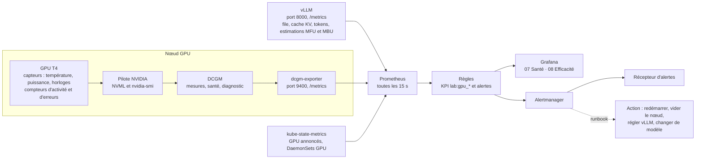

# Santé et efficacité du GPU en inférence

**En une phrase.** Un GPU peut afficher « 100 % utilisé » alors qu'il a encore de la marge, ou travailler à fond tout en étant discrètement malade, ou être en pleine forme mais mal exploité.
Ce dossier apprend à répondre, avec des chiffres et des graphiques, à quatre questions : **est-il sain ? est-il saturé ? est-il efficace ? que changer pour l'optimiser ?**

<!-- mots: gpu_util, sm_active, nvidia t4, dcgm, xid, ecc, throttling, mfu, roofline, méthode use -->
> **Mots à connaître**
> - **GPU_UTIL** : Part du temps où *au moins un* calcul tournait. **100 % ne veut pas dire saturé** (observé : le même GPU passe de 284 à 933 tokens/s à `GPU_UTIL` constant ou plus bas).
> - **SM_ACTIVE / TENSOR / DRAM_ACTIVE** : Compteurs plus fins : unités de calcul actives / tensor cores actifs / mémoire du GPU active.
> - **NVIDIA T4** : Le GPU du lab : architecture Turing, 16 Go, 70 W maximum, pas de bf16 ni FP8. Peu cher, peu puissant.
> - **DCGM** : Outil NVIDIA qui mesure le GPU ; `dcgm-exporter` publie ces mesures pour Prometheus.
> - **XID** : Code d'erreur NVIDIA signalant un problème GPU (ex. 79 : GPU tombé du bus).
> - **ECC / SBE / DBE** : Code qui détecte et corrige les erreurs de la mémoire du GPU. SBE = erreur simple, corrigée ; DBE = erreur double, non corrigeable (grave).
> - **Throttling / limite de puissance** : Watts maximum que le GPU peut consommer : 70 W par défaut sur notre T4, réglable de 60 à 70 W (`nvidia-smi -pl`). Quand il l'atteint, le GPU baisse sa fréquence (throttling).
> - **MFU / MBU** : Part du calcul (MFU) ou de la bande passante mémoire (MBU) réellement utilisée par rapport au maximum du GPU. Le MBU est le bon indicateur du décodage.
> - **Roofline** : Graphique qui dit si un calcul est limité par la mémoire ou par le calcul, selon le nombre d'opérations faites par octet lu.
> - **Méthode USE** : Pour chaque ressource, on regarde l'Utilisation (est-elle occupée ?), la Saturation (y a-t-il de la file ?) et les Erreurs.
> - Tous les mots : [glossaire](../sre/GLOSSAIRE.md).
<!-- /mots -->

Il s'appuie sur une recherche dans la documentation officielle NVIDIA, DCGM, vLLM, Azure/AKS et la littérature (liste complète et niveau de confiance de chaque source : [SOURCES.md](SOURCES.md)),
et sur les **mesures réelles du lab** (T4, 1,5B FP16 et 7B AWQ, huit situations, puis la **séance GPU du 17/11/2026** : limites confirmées, decode et prefill purs, escalier de charge, limite de puissance, DCGM, XID : [chapitre 07](07-resultats-seance.md)).

## Les quatre questions

| Question | Signaux qui répondent | Indicateurs (KPI) | Où le voir | Qui prévient |
|---|---|---|---|---|
| **1. Le GPU est-il en bonne santé ?** | température, puissance, horloges, bridage, erreurs mémoire (ECC), codes XID, lien PCIe | marges, bridage décodé, erreurs | dashboard **07 - Santé du GPU** | `LabGPUThrottling`, `LabGPUEccUncorrectable`, `LabGPUXidError`, `LabGPUThermalMarginLow`... |
| **2. Est-il saturé ?** | `SM_ACTIVE`, `DRAM_ACTIVE`, file d'attente vLLM, cache KV | utilisation et saturation (méthode USE) | dashboard **08 - Efficacité et goulot** | `LabRequestsWaiting`, `LabKVCacheSaturated` |
| **3. Est-il efficace ?** | tokens/s, watts, MFU et MBU, dollars | tokens par joule, MBU, coût d'inactivité | dashboard **08** | `LabGPUIdleCost` |
| **4. Que changer ?** | le goulot trouvé en 2 | leviers d'optimisation | arbres de décision de [04](04-diagnostic-et-optimisation.md) | - |

## Du capteur à l'alerte (diagramme)

## La méthode USE appliquée au GPU

La méthode **USE** (Utilisation, Saturation, Erreurs) consiste à poser trois questions pour **chaque ressource** : est-elle occupée ? y a-t-il de la file ? y a-t-il des erreurs ?
C'est la clé pour ne plus se contenter d'un seul chiffre (`GPU_UTIL`) : un GPU a plusieurs ressources, qui saturent séparément.

| Ressource du GPU | Utilisation (occupée ?) | Saturation (de la file ?) | Erreurs |
|---|---|---|---|
| **Calcul** (unités SM, tensor cores) | `SM_ACTIVE`, `TENSOR` | file vLLM (`requests_waiting`) quand le calcul est le goulot | XID 13, 31 (souvent l'application) |
| **Bande passante mémoire** | `DRAM_ACTIVE` (maximum pratique ≈ 0,8), MBU | cache KV plein, préemptions | ECC (SBE, DBE), pages retirées, XID 48, 63, 64 |
| **Capacité mémoire (VRAM)** | `FB_USED` sur `FB_USED + FB_FREE` | cache KV proche de 100 % | erreur de mémoire insuffisante (OOM) |
| **Puissance** | `POWER_USAGE` sur 70 W | bridage « plafond de puissance » (bit 0x4) | frein de puissance matériel (bit 0x80) |
| **Thermique** | `GPU_TEMP`, marge thermique | marge qui s'épuise | ralentissements thermiques (bits 0x20, 0x40) |
| **Lien PCIe** | débit TX/RX | - | rejeux PCIe, XID 79 |
| **Pilote et firmware** | - | - | XID 119 et 120 (GSP) |

## Ce qui existait, ce que ce dossier ajoute

| Avant (16-17/11) | Ajouté le 17/11 (validé statiquement, puis **lu sur le cluster** pendant la séance GPU) |
|---|---|
| Compteurs de base, dashboards « 02 GPU en profondeur » et « 03 Capacité et coût », alertes XID, température, bridage brut, inactivité | **9 champs DCGM de santé** (pages retirées, ECC cumulés, limites de puissance, durées de bridage), **14 règles KPI** `lab:gpu_*`, **5 nouvelles alertes** de santé et 1 alerte de bridage refondue (masque décodé), **2 dashboards** (07 et 08), **2 profils de charge** (prefill pur, decode pur), **1 scénario** (`gpu-health`), un script d'instantané `nvidia-smi`, **4 figures** tirées de vos mesures |

Validations faites : 18 tests promtool, syntaxe des 158 requêtes de dashboards, noms de champs DCGM vérifiés contre le fichier officiel de la version déployée (dcgm-exporter 4.8.4).
**Vérifié sur le cluster le 17/11/2026** ([chapitre 07](07-resultats-seance.md)) : les 9 champs de santé sont tous exportés, les 14 règles KPI évaluent sans erreur (359 règles saines au total), l'alerte d'inactivité est reçue par le récepteur, les limites du T4 sont confirmées, `dcgmi` fonctionne.
**Corrigé grâce à la séance** : le bridage au repos vaut 0 (pas 1) ; `POWER_VIOLATION` ne signale pas le plafond logiciel ; la puissance instantanée dépasse 70 W ; l'estimation MBU de vLLM est fausse d'un facteur 7 ; une règle renvoyait +Inf.
**Pas encore fait** : charge soutenue de 40 minutes, comparaison de deux GPU, `dcgmi diag` avec le GPU libre, mesure d'efficacité à faible débit.

## Ordre de lecture

1. [01 - Les signaux du GPU](01-signaux-du-gpu.md) : chaque compteur expliqué, ses valeurs réelles sur T4, le décodage du bridage, le roofline.
2. [02 - Les KPI proposés](02-kpi.md) : l'arbre des indicateurs, les formules, les seuils, l'équivalent des contrôles de santé GPU d'AKS.
3. [03 - Les dashboards](03-dashboards.md) : deux nouveaux tableaux de bord, leur plan et leur mode de lecture.
4. [04 - Diagnostic et optimisation](04-diagnostic-et-optimisation.md) : états de santé, table XID, arbres de décision, leviers chiffrés.
5. [05 - Simulations](05-simulations.md) : la séance de mesures (parcours court et complet), avec ce qu'on ne fera pas et pourquoi.
6. [06 - Compétences NCP-AIO](06-competences-ncp-aio.md) : ce que ce travail démontre, point par point, et ce qu'il ne démontre pas.
7. [07 - Résultats de la séance GPU](07-resultats-seance.md) : tout ce qui a été mesuré le 17/11/2026, avec les corrections de nos hypothèses.
8. [SOURCES](SOURCES.md) : toutes les sources, ce qu'on en a retenu, et les écarts constatés.

Liens utiles : [glossaire](../sre/GLOSSAIRE.md) · [module 5 de la formation](../formation/05-lire-un-gpu.md) · [guide GPU T4](../guide/05-gpu-t4.md).
