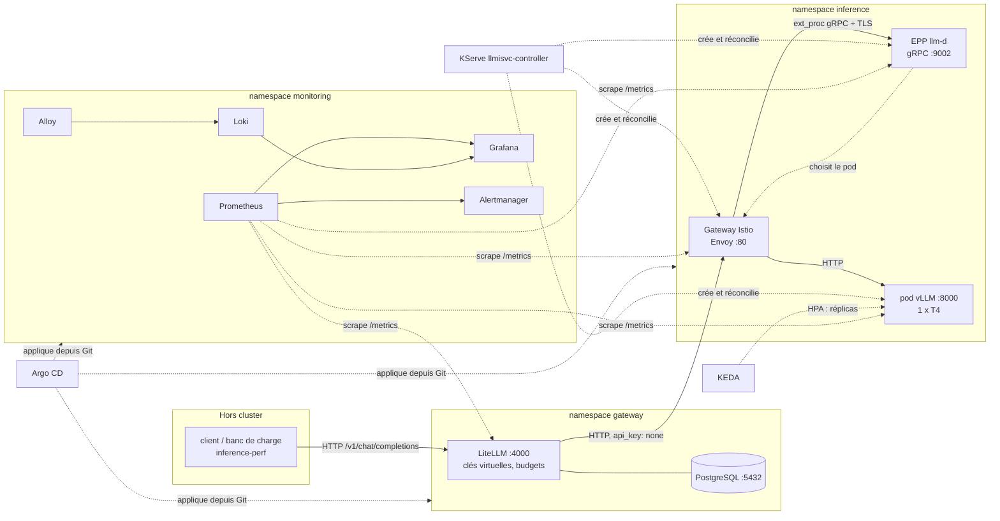

# 02 - Architecture du cluster

## 1. Vue d'ensemble

Trois « plans » à distinguer :

| Plan | Rôle | Composants |
|---|---|---|
| **Données** (chemin d'une requête) | transporter et calculer | LiteLLM, Gateway Istio, EPP, vLLM, GPU |
| **Contrôle** | créer, réconcilier, ajuster | Argo CD, KServe, KEDA, GPU Operator, cert-manager, istiod, kube-controller (AKS) |
| **Observation** | mesurer et alerter | Prometheus, Grafana, Loki, Alloy, Alertmanager, DCGM exporter |

## 2. Le chemin d'une requête, étape par étape

Exemple : `POST /v1/chat/completions` avec `model: qwen-7b-awq`.

| # | Où | Ce qui se passe | Preuve |
|---|---|---|---|
| 1 | client -> LiteLLM `:4000` | le client présente une **clé virtuelle** (`Authorization: Bearer sk-...`). LiteLLM vérifie la clé, l'équipe, le budget et les limites dans PostgreSQL | (observé) équipes `lab-bench` / `lab-user` |
| 2 | LiteLLM | `model_name: qwen-7b-awq` est traduit en `hosted_vllm/Qwen/Qwen2.5-7B-Instruct-AWQ` et envoyé à `http://inference-gateway-istio.inference.svc.cluster.local/inference/qwen-7b-awq/v1/chat/completions` | (config) `gitops/gateway/litellm/templates/configmap.yaml` |
| 3 | Gateway Istio (Envoy) | une règle `HTTPRoute` reconnaît le préfixe `/inference/qwen-7b-awq/v1/chat/completions`, le **réécrit** en `/v1/chat/completions` et désigne l'`InferencePool` comme backend. Pas de timeout de requête (`request: 0s`) | (observé) `docs/reference/routing.yaml` |
| 4 | Envoy -> EPP | un filtre **ext_proc** envoie les en-têtes (et le corps) de la requête à l'EPP par gRPC sur `:9002`, **en TLS auto-signé** | (observé) sans `DestinationRule` TLS : `ext_proc_error_gRPC_error_14`, HTTP 500 ; (doc) le protocole ext_proc de la Gateway API Inference Extension transmet en-têtes et corps |
| 5 | EPP | il connaît tous les pods vLLM du pool et leurs métriques (file, cache KV, cache de préfixes). Il applique ses filtres et scorers et **renvoie l'adresse du pod retenu** | (observé) EPP `qwen-.../router-scheduler`, plugins `approx-prefix-cache-producer`, `inflight-load-producer`, `prefix-cache-affinity-filter`, `token-load-scorer` |
| 6 | Envoy -> pod vLLM | Envoy envoie la requête **directement à l'IP du pod** désigné, port 8000, en HTTP | (doc) l'EPP renvoie l'endpoint choisi, Envoy s'y connecte ; (observé) les requêtes se répartissent entre les pods (277 / 299 sur 2 réplicas) |
| 7 | vLLM | tokenise, **prefill**, puis **decode** token par token ; en streaming, chaque token repart en SSE (`data: {...}`) | (observé) |
| 8 | retour | pod -> Envoy -> LiteLLM -> client. LiteLLM comptabilise tokens et coût (PostgreSQL) et expose ses métriques sur `:9400` | (observé) |

Les requêtes qui ne sont **pas** des appels d'inférence (par exemple `GET /v1/models`) suivent la règle « catch-all » de l'`HTTPRoute` : elles vont **directement au Service** du workload, sans passer par l'EPP
(observé : `route_name: v1-catch-all-path`, `upstream_cluster: ...workload-svc`).

## 3. Qui crée quoi

L'utilisateur ne déclare qu'une chose pour le serving : un objet **`LLMInferenceService`** (`gitops/serving/chart/templates/llmisvc.yaml`).
Le contrôleur KServe (`llmisvc-controller-manager`) le combine avec des **presets** (`LLMInferenceServiceConfig`, namespace `kserve`) et crée :

| Objet créé par KServe | Rôle |
|---|---|
| `Deployment <nom>-kserve` | les pods vLLM (+ init container `storage-initializer` qui télécharge le modèle) |
| `Service <nom>-kserve-workload-svc` | accès aux pods vLLM (`:8000`, port nommé `http`) |
| `Deployment <nom>-kserve-router-scheduler` | l'EPP llm-d |
| `Service <nom>-epp-service` | `:9002` gRPC, `:9003` santé, `:9090` métriques, `:5557` zmq |
| `InferencePool <nom>-inference-pool` | « ces pods forment un pool, voici son EPP » (API Gateway API Inference Extension) |
| `HTTPRoute <nom>-kserve-route` | règles de routage vers l'InferencePool |
| `ServiceAccount/Role/RoleBinding <nom>-epp-*` | droits de l'EPP (lire les pods, les InferencePool, les EndpointSlices) |
| `ScaledObject` + `HPA keda-hpa-...` | si le scénario déclare `spec.scaling.keda` |

Ce que nous ajoutons nous-mêmes autour : la `Gateway` (`gitops/gateway/inference-gateway`), la `DestinationRule` TLS vers l'EPP (`gitops/serving/chart/templates/epp-tls.yaml`).

## 4. Namespaces et placement

| Namespace | Contenu | Nœud |
|---|---|---|
| `argocd` | Argo CD (5 workloads) | système |
| `cert-manager` | cert-manager (3 workloads) | système |
| `gpu-operator` | opérateur + NFD (système) ; driver, toolkit, device plugin, DCGM, validator (nœud GPU) | les deux |
| `istio-system` | istiod | système |
| `keda` | KEDA (3 workloads) | système |
| `kserve` | contrôleur llmisvc, presets | système |
| `lws-system` | LeaderWorkerSet (dépendance de KServe, inutilisé ici) | système |
| `gateway` | LiteLLM, PostgreSQL | système |
| `inference` | Gateway Istio, EPP (système), pod vLLM (GPU), jobs de bench (système) | les deux |
| `monitoring` | Prometheus, Grafana, Alertmanager, Loki, Alloy, kube-state-metrics, node-exporter, alert-sink | système (+ DaemonSets sur le GPU) |

Deux pools de nœuds **(config, `infra/terraform/main.tf`)** :
- **système** `Standard_D4as_v7` (4 vCPU, 16 Gio), label `workload=platform`, tout le reste ;
- **GPU** `Standard_NC4as_T4_v3` (4 vCPU, 28 Gio, 1 T4), label `workload=inference`, taint `sku=gpu:NoSchedule` : seuls vLLM et les DaemonSets du GPU Operator, d'Alloy et de node-exporter y tolèrent le taint.

Le banc de charge (`inference-perf`) s'exécute volontairement sur le pool **système** : il ne doit jamais prendre de CPU au pod vLLM (4 vCPU seulement sur le nœud GPU).

## 5. Ports et protocoles

| Source -> destination | Port | Protocole | Chiffrement |
|---|---|---|---|
| client -> LiteLLM | 4000 | HTTP (SSE en streaming) | aucun (port-forward ou ClusterIP) |
| LiteLLM -> Gateway Istio | 80 | HTTP | aucun |
| Envoy -> EPP | 9002 | gRPC (ext_proc) | **TLS auto-signé**, vérification désactivée (`insecureSkipVerify`) |
| Envoy -> vLLM | 8000 | HTTP | aucun |
| Prometheus -> vLLM, EPP, LiteLLM, Envoy, istiod, DCGM... | 8000, 9090, 9400, 15090, 15014, 9400 | HTTP (sauf KServe : HTTPS) | l'EPP exige un **jeton** de ServiceAccount |
| KEDA -> Prometheus | 9090 | HTTP | aucun |
| Argo CD -> GitHub | 443 | HTTPS | dépôt public, accès anonyme |
| storage-initializer -> Hugging Face | 443 | HTTPS | anonyme (secret `hf-token` vide) |

Rien n'est exposé sur Internet : tous les Services sont `ClusterIP` ; l'accès humain se fait par `kubectl port-forward` (`lab.sh ui`).
Seule exception réseau sortante : AKS fournit un Standard Load Balancer pour la sortie des nœuds (téléchargements d'images, Hugging Face, GitHub).

## 6. Ordre de démarrage (GitOps)

Terraform crée l'infrastructure puis installe **Argo CD** et l'**application racine**. Celle-ci rend 19 `Application` (une par composant), annotées par des **vagues** (`sync-wave`) :

| Vague | Composants (azure) |
|---|---|
| 0 | CRDs Gateway API (v1.5.1), CRDs GIE (v1.5.0) |
| 1 | cert-manager, kube-prometheus-stack, **GPU Operator**, **pré-tirage de l'image vLLM** |
| 2 | istio-base (CRDs Istio) |
| 3 | istiod, KEDA, LeaderWorkerSet, Loki, Alloy |
| 4-6 | KServe (CRDs, contrôleur, presets), Gateway |
| 7-8 | serving (LLMInferenceService), PostgreSQL, LiteLLM |
| 9 | ServiceMonitors, règles, dashboards |

**Réserve (observé)** : les vagues ordonnent la création des `Application`, mais Argo CD ne bloque pas toujours la suivante ; certains composants échouent à leur première tentative (CRDs de Prometheus absentes, par exemple)
puis réussissent aux **réessais** (backoff). La convergence est garantie par réessais, pas par l'ordre. Elle a pris ~10 min 30 sur la dernière installation complète.
Note : le déplacement du GPU Operator et le pré-tirage en vague 1 sont des changements **non retestés depuis zéro** (voir `docs/BASELINE.md` §3 pour les mesures avant changement).

## 7. Tout est dans Git

Rien ne se configure à la main :

| Quoi | Où |
|---|---|
| Infrastructure Azure, Argo CD, secrets, application racine | `infra/terraform/` |
| Liste des composants et versions | `gitops/root/values.yaml`, `gitops/root/versions.yaml` |
| Valeurs de chaque chart | `gitops/platform/*/values.yaml`, `gitops/observability/*/values*.yaml` |
| Scénario actif | `gitops/active-azure.yaml` (changé par `lab.sh scenario`) |
| Modèles et réglages vLLM | `gitops/scenarios/<nom>.yaml` + `gitops/serving/chart/values.yaml` |
| Dashboards, règles, alertes, monitors | `gitops/observability/config/` (les dashboards sont générés par `tests/gen_dashboards.py`) |

Argo CD a `selfHeal` et `prune` : une modification manuelle est annulée (testé : un `scale` à 0 d'un déploiement est revenu à 1 en 4 secondes).
